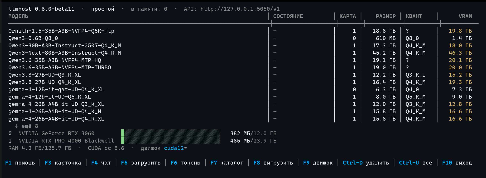

# llmhost

> Другие языки: [English](docs/README.en.md) · [中文](docs/README.zh.md) · [Português (BR)](docs/README.pt-br.md)

llmhost предназначен для локального запуска больших языковых моделей (LLM) на вашей машине под ОС Linux. Обеспечиваются приватность и возможность работы в автономной среде. Это обёртка над llama.cpp, которая, используя оптимизированные, автоматически вычисляемые параметры запуска LLM, позволяет достичь наиболее полной утилизации системных ресурсов и значительно увеличить скорость инференса LLM.

Приложение состоит из `llmhostd` — фоновой службы, которая запускает модели и следит за памятью видеокарт, а также из `lhctl` — консольного интерфейса на базе TUI, позволяющего управлять работой приложения, изменять его параметры, управлять движками, на которых работает приложение, создавать токены для доступа к API приложения и управлять ими.

В качестве ядра используются — обычные сборки [llama.cpp](https://github.com/ggml-org/llama.cpp), без своих патчей.



---

## Основные возможности

- **Единый интерфейс доступа к LLM.** Клиент настраивается на BaseURL `http://127.0.0.1:7330/v1`. Токен доступа настраивается и управляется в TUI `lhctl`. Какую бы модель вы ни выбрали, BaseURL и токен останутся теми же.
- **Несколько моделей сразу.** В видеопамяти могут размещаться сразу несколько моделей. Количество зависит от величины VRAM (видеопамяти). По умолчанию не больше двух: например, разговорная модель и модель для поиска по документам. Запрос сам выбирает модель по имени. Если для новой модели не хватило места, то выгружается та, к которой дольше всех не обращались. Следующий запрос к ней поднимет её снова.
- **Multi-GPU конфигурация.** Модель размещается на самой быстрой карте, куда она помещается целиком. Если в момент загрузки на этой карте мало свободной памяти, берётся следующая, где места хватает. Модель, которая не помещается ни на одну карту, делится по всем. У MoE-моделей эксперты при нехватке места размещаются в оперативной памяти.
- **Каталог моделей с подсказками.** Реализован поиск моделей из утилиты `lhctl` (команда `search` или каталог в полноэкранном режиме). Ещё до скачивания видно, поместится ли модель и с каким максимальным контекстом. Интерфейс каталога показывает рекомендованный квант модели. При загрузке поддерживается дозагрузка в случае обрыва соединения; идущее скачивание можно остановить на лету (`lhctl pull stop` или `Ctrl-X` в интерфейсе) — недокачанный файл остаётся и продолжается при повторе. Целостность загруженного файла проверяется по алгоритму SHA256.
- **Автоматический подбор параметров под ваше железо.** Перед запуском алгоритмы llmhost сами выбирают размер контекста, сжатие KV-кэша и то, как разложить большую MoE-модель. Можно положиться на автоматическую настройку, как правило она выдаёт оптимальные параметры. Если же хотите, то можно включить режим ручной настройки через `lhctl`, поставив параметр `auto-params = false` и переопределив остальные параметры.
- **Автоопределение и подключение MTP.** Родной MTP-модуль или встроенные nextn-слои (Qwen3.6, GLM) подключаются сами. `lhctl pull` вместе с выбранным квантом скачивает подходящий MTP-модуль и vision-проекцию, если они есть в репозитории: из нескольких квантов модели MTP берётся тот же класс, что у основной модели. Использование включается/выключается в карточке модели ключами `mtp-mode = off/on/auto`.
- **Управление thinking.** Рассуждения модели перед ответом включаются и выключаются per-model: `lhctl thinking <модель> auto|on|off`, клавиша T карточки TUI. Режим едет ребёнку флагом `--reasoning`; `auto` — движок сам решает по шаблону.
- **Умное удержание видеопамяти.** Модель, к которой никто не обращается, выгружается из видеопамяти спустя 15 минут простоя. Время удержания модели в VRAM можно определить в настройках. Запрос из приложения по API, адресованный к модели, автоматически размещает её в видеопамяти.
- **Метрики.** `/v0/metrics` отдаёт метрики в формате Prometheus: запросы, ошибки, токены, скорость генерации, память карт — плюс точная телеметрия движка по-модельно (скорости декода и префилла, приём спекции), снятая с движков в живом состоянии. Таблицей и графиком это видно в `lhctl metrics -w` и на экране метрик TUI (клавиша `m`).
- **Закрытый API.** Локальный API, в отличие от приложений других вендоров, требует персональный токен доступа. Посторонняя программа на том же компьютере не сможет пользоваться моделью молча. Это сделано с целью контролируемого использования ресурсов машины.

---

## Установка одной командой

Установщик берёт статический архив с GitHub Releases. Исполняемые файлы не имеют внешних зависимостей. **Root не нужен и sudo не используется**: исполняемые файлы ставятся в `~/.local/lib/llmhost`, симлинк `lhctl` — в `~/.local/bin`, служба — systemd **user**-юнит, данные — `~/.local/share/llmhost`; всё живёт в домашнем каталоге. В системе для правильной установки приложения должны быть `curl`, `tar`, `sha256sum` и systemd.

**Дистрибутив — Ubuntu.** Разработка и тестирование ведутся на Ubuntu; на других дистрибутивах полноценная работоспособность не гарантируется — тестирование не проводилось.

```bash
curl -fsSL https://github.com/bkisonka/llmhost/releases/latest/download/install.sh | sh
```

Скрипт спросит каталог для моделей и покажет путь по умолчанию. Ответ записывается в конфигурационный файл `llmhost.conf`. Задать каталог без вопроса можно флагом `--models-dir ПУТЬ`. Дальше скрипт проверит целостность архива, поставит `llmhostd`, `lhctl` и манифест в `~/.local/lib/llmhost`, сделает символическую ссылку `lhctl` в `~/.local/bin` (она попадёт в `PATH`), зарегистрирует службу systemd, запустит её и установит ядро системы — llama.cpp («движок»). Если в системе есть `nvidia-smi`, то будет выбран релиз для `cuda12`, иначе релиз llama.cpp для `vulkan`.

Флаги: `--version ТЕГ` (конкретный релиз вместо последнего), `--engine cuda12|vulkan|none`, `--no-engine`, `--no-start` (не трогать systemd), `--models-dir ПУТЬ`. Для зеркал и нестандартных путей есть переменные `LLMHOST_BASE_URL`, `LLMHOST_DIR`, `LLMHOST_BIN_DIR`, `LLMHOST_MODELS_DIR`. Подробности: `install.sh --help`.

**Откуда что загружается.** Движок llama.cpp демон загружает сам — только из официальных релизов llama.cpp (github.com/ggml-org/llama.cpp): адреса и SHA256 зафиксированы в `manifest.json`. Модели — с HuggingFace, загружаются со сверкой SHA256. Других сетевых источников нет. **Качать llama.cpp через интерфейс приложения не обязательно**: загрузите релиз llama.cpp с той же страницы и распакуйте его в `<каталог данных>/engine/cuda12/` (для Vulkan — `engine/vulkan/`) — демон сам увидит сборку как установленную, `lhctl engine` покажет её с галочкой; поиск llama.cpp рекурсивный. Установщик может провести установку вообще без движка (параметр `--no-engine`). Любой произвольный llama.cpp из любого места — ключом `[general] llama-server` с путём в `llmhost.conf`.

**Обновление** — выполняется аналогично установке. Демон останавливается, файлы заменяются, служба поднимается. Данные, модели и накопленные замеры остаются. Если порт управления нестандартный, перед обновлением выполните `export LHCTL_PORT=ПОРТ`. Сам llama.cpp обновляется отдельно: `lhctl engine update`.

Все данные лежат в `~/.local/share/llmhost`. Если задан `$XDG_DATA_HOME`, то в `$XDG_DATA_HOME/llmhost`. Переменная `LH_DATA_DIR` переопределяет это место. Там конфиг `llmhost.conf`, ключи `token.txt` и `api_tokens.json`, движок, модели и журнал `log.txt`.

### Первый запуск с нуля

```bash
lhctl status                  # служба уже поднята установщиком
lhctl pull qwen3              # модель: квант подберётся под ваши карты
lhctl chat qwen3 "привет!"    # разговор
lhctl                         # полноэкранный интерфейс (реестр, каталог, чат)
```

---

## Сборка из исходников и служба systemd

```bash
cmake -S . -B build-linux && cmake --build build-linux -j$(nproc)
LH_LOG_STDERR=1 ./build-linux/llmhostd      # запуск на переднем плане
./build-linux/lhctl status                  # другой терминал
```

**Работа в качестве службы** (основной способ): установку user-юнита systemd выполняет скрипт `scripts/install-systemd.sh`. Он записывает `~/.config/systemd/user/llmhostd.service` и выполняет `enable --now`. Далее:

```bash
systemctl --user status llmhostd
systemctl --user restart llmhostd   # после правки портов в llmhost.conf
journalctl --user -u llmhostd -f    # живой хвост журнала
loginctl enable-linger              # поднимать при старте машины без входа
```

В юните задано `Restart=always`: демон постоянно находится под управлением юнита. Даже корректное завершение (`lhctl quit`, SIGTERM) рассматривается юнитом как сбой, и через две секунды демон запускается повторно. Намеренная остановка выполняется только командой `systemctl --user stop llmhostd`. Запуск бинарного файла вручную через setsid или nohup не рекомендуется: процесс выйдет из-под управления юнита.

`KillMode=control-group` означает, что остановка юнита завершает и демон, и все процессы llama-server. Если демон аварийно завершается вне systemd, осиротевшие процессы устраняются при его следующем запуске. В журнале им соответствуют строки `orphan:`.

Релизный архив собирается скриптом `scripts/package_release.sh [версия]`: выполняется статическая сборка и юнит-тесты; в `dist/` создаются архив `llmhost-<ver>-linux-x64.tar.gz`, файл с контрольной суммой и файлы для релиза.

---

## lhctl: краткий справочник

`lhctl` — консольный клиент control API. Ключ и каталог данных совпадают с используемыми демоном. Без аргументов в терминале открывается полноэкранный интерфейс.

```bash
lhctl                            полноэкранный интерфейс: реестр моделей,
                                 память карт, каталог, чат, токены
lhctl status                     приборная панель: VRAM-бары по картам, модели;
                                 -w — обновлять живьём
lhctl models [--raw]             реестр моделей; --raw — идентификаторы построчно
lhctl search qwen3               поиск по каталогу HuggingFace: размер, оценка
                                 VRAM, влезет ли на ваши карты (→ lhctl pull)
lhctl pull qwen3                 поставить модель по имени: квант под карту
                                 выберется сам (+mmproj и MTP-модуль, если есть)
lhctl pull stop                  остановить идущее скачивание: недокачанный
                                 файл остаётся, повторный pull докачит
lhctl chat qwen3                 диалог в терминале (стрим, /bye — выход)
lhctl chat qwen3 "вопрос"        один вопрос — один ответ (для скриптов)
lhctl bench                      замер сборок движка на модели
lhctl engine                     движок: пин манифеста, сборки, статусы
lhctl engine update              свежий b-релиз llama.cpp: пин + установка
lhctl engine install cuda12      (пере)установить сборку из текущего пина
lhctl engine use cuda12          выбирать сборку запуска явно (auto — по железу)
lhctl load Qwen3-0.6B-Q8_0       загрузить (имя из реестра или путь к .gguf)
lhctl show Qwen3-0.6B-Q8_0       карточка модели: архитектура, квант, контекст
lhctl ctx qwen3 32768            ручной контекст модели (auto — снять)
lhctl set                        таблица ключей [general] и запись в конфиг
lhctl tokens add rag2            именованный токен /v1 (rm — отозвать)
lhctl rm Qwen3-0.6B-Q8_0         удалить модель безвозвратно (со спутниками;
                                 спросит, --yes — без вопроса)
lhctl image                      генерация изображений: статус и каталог художников
lhctl image pull z-image-turbo   скачать художника (без имени — каталог встроенных;
                                 или org/repo с раскладкой recipes/ + категории)
lhctl image rm flux3-klein       удалить художника с диска (загруженную
                                 демон остановит сам; --yes — без вопроса)
lhctl image load flux3-klein     загрузить (unload — остановить; к модели
                                 обращаются запросы /v1/images/* OpenAI-порта)
lhctl unload [модель]            выгрузить одну (или все — без имени);
                                 --force — занятую принудительно: обрывает
                                 все генерации модели для её клиентов
lhctl mtp qwen3 off              спекуляция модели: auto / on / off (как lhctl ctx)
lhctl quit                       завершить демона
```

**Полноэкранный интерфейс.** Стрелки и PgUp/PgDn выбирают модель. `Enter` или `F3` открывают карточку (`C` задаёт контекст вручную, `M` переключает mtp-режим, для загруженной модели карточка показывает живые аргументы дочернего процесса). `F2` — подробный статус загруженных моделей: слои, их размещение, черновик, KV. `F4` — чат, `F5` загружает модель в видеопамять, `F7` — каталог с поиском и квантами, `F6` — токены доступа, `F8` выгружает выбранную модель (если она занята генерацией — предложит подтвердить принудительную остановку), `Ctrl-U` — все сразу, `F9` — движок с живым прогрессом установки, `Ctrl-D` удаляет модель с диска, `Ctrl-X` останавливает идущее скачивание (с любого экрана), `i` — раздел изображений (художники: каталог, загрузка, скачивание, удаление). Данные на экране обновляются раз в секунду. При выходе терминал возвращается в исходное состояние.

**Автодополнение** (bash): добавьте `source <(lhctl completion bash)` в `~/.bashrc` — после этого `lhctl load <TAB>` выводит идентификаторы из реестра.

**Определение ключа и порта.** Токен берётся из `token.txt` в каталоге данных (`~/.local/share/llmhost`). Порт управления по умолчанию — 7331. Оба значения переопределяются флагами `--token` и `--port` либо переменными `LHCTL_TOKEN` и `LHCTL_PORT`. Ответы выводятся в stdout, ошибки — только в stderr. Коды выхода для скриптов: **0** — успех, **1** — сервер недоступен, **2** — неверный токен (401), **3** — ошибка запроса (404/500), **4** — ошибка аргументов.

---

## Жизненный цикл модели: загрузка, удержание, выгрузка

- **Загрузка** занимает секунды. Состояние и занятая видеопамять отображаются в `lhctl status` и `/v0/status`.
- **Умное удержание видеопамяти.** Если в течение `unload-after-min` минут (по умолчанию пятнадцать) обращений к модели нет, она автоматически выгружается из видеопамяти. Для клиента это незаметно: первый запрос повторно размещает модель, ответ приходит с задержкой в несколько секунд. Каждая выгрузка фиксируется в журнале.
- **Отмена запроса клиентом останавливает генерацию.** Если клиент обрывает соединение (отмена задачи в приложении, закрытие вкладки), демон замечает это и гасит брошенную генерацию: модель не дожёвывает отменённый запрос вхолостую, занятость и слот освобождаются сразу. Событие пишется в журнал и учитывается метрикой `client_gone` (`GET /v0/metrics`).
- **Ручная выгрузка** — `lhctl unload` или клавиша `F8`. Память освобождается сразу, выбор модели сохраняется. Занятая генерацией модель без явного решения не трогается — отказ с пояснением; `lhctl unload <модель> --force` (в TUI — подтверждение по `F8`) останавливает модель принудительно: все её генерации обрываются для всех клиентов.
- При нехватке памяти или повреждении файла в журнале появляется запись, а модель получает в реестре пометку `failed`. Если модель не поместилась целиком, планировщик автоматически снижает параметры до запуска и фиксирует, что именно изменено.

---

## Одновременное обслуживание нескольких моделей

Демон удерживает **несколько моделей одновременно** — столько, сколько задаёт `models-max` (по умолчанию 2; `1` — держать одну модель, `0` — без лимита) и сколько помещается в видеопамяти. Параметры каждой модели рассчитываются отдельно.

- **Загрузка второй модели — обе остаются в памяти.** Состояния видны в `lhctl status` и `lhctl models`.
- **При нехватке места выгружается простаивающая модель, к которой дольше всех не обращались.** Событие фиксируется в журнале. Выгруженная модель автоматически поднимается следующим запросом.
- **Выбор модели каждым запросом.** В OpenAI-запросе это поле `model`. Список имён возвращают `GET /v1/models` и `lhctl models --raw`. Если поле пустое, отвечает последняя загруженная модель.
- **Параллельные запросы.** Одна модель может обслуживать несколько клиентов одновременно. Ключ `parallel` (по умолчанию 1) задаёт число потоков. Контекст модели делится между ними поровну, бюджет памяти пересчитывается, чтобы всё поместилось.
- **Эмбеддинг-модели.** Семейства вроде BERT (nomic-embed, bge, e5, gte) распознаются по архитектуре; обращения выполняются через `/v1/embeddings`. В чатах они не участвуют.

---

## Оркестрация на стороне демона (harness)

Режим работы демона — harness: решения о том, какую модель загружать, на какую карту и когда, принимает демон, а не движок. Для каждой модели в видеопамяти запускается **отдельный** процесс llama-server. Прокси распределяет запросы по полю `model`.

Это обусловлено тем, что внутренняя реализация роутера llama.cpp меняется от релиза к релизу, и каждое обновление требовало повторной проверки поведения движка. В harness движок заменяется без изменения логики демона: планы размещения, вытеснение, спекуляция, vision и ручной контекст.

Правила для нескольких пользователей:

- **Занятая модель не выселяется.** Пока выполняется генерация, слот модели не затрагивается независимо от источника запроса. `lhctl unload` и `POST /v0/unload` для занятой модели возвращают отказ с пояснением. Люк один и явный: `POST /v0/unload` с `"force": true` (или `lhctl unload <модель> --force`) снимает модель принудительно, обрывая все её генерации для всех клиентов.
- **При нехватке места выселяются только незанятые модели.** Если новой модели не хватает памяти, демон автоматически выгружает простаивающие модели и загружает новую.
- **Если память удерживают занятые модели, запрос ожидает.** Он помещается в очередь и выполняется после освобождения и выгрузки соседней модели. При превышении `queue-ttl` секунд (по умолчанию 120) клиент получает 504 с пояснением вместо последовательности неочевидных ошибок. Число запросов, ожидающих одну модель, задаёт `queue-depth` (по умолчанию 16). Очередь наблюдается в метриках `llmhost_queue_depth`, `llmhost_queue_wait_ms` и `llmhost_queue_timeouts_total` на `GET /v0/metrics`.
- **После перезапуска демона модели восстанавливаются.** Список моделей, находившихся в видеопамяти, сохраняется в `state.json`.

Ключи: `queue-ttl` (нулевое значение — ожидание запрещено: при занятости немедленный отказ с пояснением) и `queue-depth`. Оба применяются без перезапуска.

---

## Конфигурации с несколькими GPU

Служба определяет все карты через NVML и размещает модели автоматически.

Основной картой модели назначается самая быстрая, на которой она помещается целиком. Карты сортируются по вычислительной мощности: сначала compute capability, при равенстве — по объёму памяти. Карты, на которые модель не помещается даже целиком, из распределения исключаются.

Если в момент загрузки на основной карте недостаточно свободной памяти, используется следующая карта с достаточным объёмом. Ручные `main-gpu` и `tensor-split` имеют приоритет над этим выбором.

Модель, не помещающаяся ни на одну карту, распределяется по всему пулу. Плотная модель крупнее **суммарного объёма пула** работает в гибридном режиме: слои распределяются по картам пропорционально памяти, оставшаяся часть (хвост) размещается в оперативной памяти. У MoE-моделей эксперты переносятся в оперативную память целиком. Перед загрузкой тяжёлой модели простаивающие выгружаются автоматически, если по плану места недостаточно.

- Оценка размещаемости выполняется для карты, на которую нацелена модель. Память каждой карты показывают `lhctl status` и `GET /v0/status` (массив `gpus`). `lhctl models` указывает карту для каждой модели. Значение −1 означает распределение по всем картам.
- Ручная привязка — ключ `main-gpu` в секции модели `llmhost.conf`. Это предпочтение: если на указанной карте модель целиком не помещается, а на другой помещается, демон перенесёт её и зафиксирует в журнале: «пин карты N не вмещает — целиком на карту M».
- `tensor-split` задаёт доли карт явно и выполняется как указано. Тем же ключом задаётся частичная выгрузка слоёв на карте с малым объёмом памяти, например `main-gpu = 0` и `tensor-split = 1,0`. На декодировании, ограниченном процессором, спекуляция даёт наибольший выигрыш (см. раздел ниже).
- Две модели могут быть привязаны к одной карте. Одновременная работа возможна, только если помещаются обе; иначе первая остаётся в памяти, вторая получает пометку `failed`. Автоматического вытеснения по месту в этом случае нет.
- Движок запускается с `CUDA_DEVICE_ORDER=PCI_BUS_ID`. Без этого CUDA нумерует карты по скорости, и привязка может оказаться на другой карте.

На стенде с двумя картами (3060 на 12 ГиБ и RTX PRO 4000 Blackwell на 24 ГиБ, замер 02.10.2026) Qwen3.8-27B Q4_K_XL в разделённом режиме показывала 23 ток/с, с родным MTP-модулем — 36 ток/с. MoE 30B-A3B с экспертами в оперативной памяти — 26 ток/с. Каталог оценивает размещаемость по суммарному объёму всех карт.

---

## Добавление и удаление моделей

Каталог моделей — обычная папка (`models-dir`). llmhost отслеживает её автоматически.

- **Размещение `.gguf`-файла в каталоге** (ручное скачивание или копирование с другого компьютера): в течение нескольких секунд модель появляется в реестре и в списке API. Перезапуск не требуется, загруженные модели не затрагиваются. Группа файлов llama.cpp вида `…-00001-of-00004.gguf` — одна модель, а не отдельная запись на каждую часть.
- **Удаление файла вручную** — модель аналогично исчезает из реестра.
- **`lhctl rm`** (или `Ctrl-D` в полноэкранном интерфейсе) удаляет модель вместе со спутниками: vision-проекцией, MTP-модулем и всеми частями группы. На сервере без графической среды корзины нет — удаление выполняется немедленно и безвозвратно. Команда запрашивает подтверждение; флаг `--yes` отключает и его. Загруженная модель перед удалением выгружается автоматически.

---

## Изображения: каталог художников

Генерация картинок обслуживается вторым движком (sd-server), у него свой каталог моделей: `diffusion_models/`, `text_encoders/`, `vae/`, рецепты `recipes/*.json` и привязки `llmhost-image.json`. Один механизм скачивания на все модели приложения:

- **`lhctl image pull <имя>`** — скачать художника из встроенного каталога (без имени — список): записи подобраны по реальным репозиториям HuggingFace (кванты диффузии и энкодеров у unsloth, VAE в comfy-репозиториях оригиналов), SHA256 проверяется, недокачки продолжаются. Файлы ложатся по категориям, привязка и рецепт записываются сами — модель сразу видна в `lhctl image` и в селекторе `/v1/images/models`.
- **Свой источник** — репозиторий `org/repo` с раскладкой-конвенцией: ровно один `recipes/*.json` (формат sd-server) и по одному файлу в `diffusion_models/` (`.gguf`), `text_encoders/` (`.gguf`) и `vae/`.
- **`lhctl image rm <имя>`** — удалить художника с диска: файлы слотов, свободный рецепт и запись привязки; загруженную модель демон остановит сам. Подтверждение запрашивается, `--yes` отключает.

Редактирование по изображению (`/v1/images/edits`) доступно только моделям, чей рецепт заявляет фичу `ref_images` в `features` (это поле рецепта читает и сам движок: не заявлено — считается неподдерживаемым). Запрос к модели без фичи получает честный `400` с подсказкой, движок не будится.

---

## Переопределение параметров по модели

Автоматический подбор в большинстве случаев даёт оптимальный результат. Если требуются индивидуальные значения, в том же `llmhost.conf` создаётся секция для модели. Заголовок секции — имя файла без `.gguf`. Изменения применяются в течение нескольких секунд, перезапуск не нужен:

```ini
[Qwen3.8-27B-UD-Q4_K_XL]
main-gpu = 1
cache-type = q8_0
ctx-size = 65536
system = Ты — дежурный ассистент. Отвечай кратко.
```

Комментарий — строка целиком, начинающаяся с `#` или `;`. Старый `model_overrides.json` читается, только если `llmhost.conf` отсутствует.

| Ключ | Смысл |
|------|-------|
| `ctx-size` | общий контекст модели (делится между потоками `parallel`) |
| `n-gpu-layers` | сколько слоёв на GPU (0 — как рассчитал планировщик) |
| `main-gpu` | привязка к карте (0, 1, …); −1 или пусто — авто |
| `tensor-split` | пропорции сплита по картам, напр. `0,1` — всё на карту 1 |
| `cache-type` | KV-кэш: `f16` / `q8_0` / `q4_0` |
| `mtp-mode` | спекуляция этой модели: `on` / `off` — детерминированно, поверх контролёра и голов; `auto` — решает глобальный ключ (снять переопределение) |
| `system` | системный промпт клиентам, не приславшим свой |
| `model-draft` | draft-модель для спекуляции (id/имя/путь) |
| `spec-type` | `draft-simple` (дефолт), `draft-mtp`, `eagle3`, `ngram-*` |
| `draft-card` | `spare` — файловый `draft-simple` на запасную карту (harness; MTP-черновик обязан находиться на карте ствола — общий граф KV, перенос нарушает загрузку). Назначение — освободить VRAM ствола; скорость черновика на слабой карте обычно ниже |
| `expert-card` | `spare` — часть блоков экспертов MoE на запасную карту при полном выносе `exps=CPU` (harness; частичную форму `n-cpu-moe` не затрагивает) |

**Спекуляция.** У моделей со встроенным MTP (Qwen3.6/3.5, GLM-4.5 и похожие) ускорение включается без ключей. Признак `nextn_predict_layers` читается из GGUF, спекуляция работает в режиме `draft-mtp`.

Если у модели есть родной MTP-модуль в подпапке `MTP/` репозитория на Hugging Face, `lhctl pull` скачает подходящий по кванту файл вместе с моделью, и при загрузке он подключится автоматически. Если модулю не хватило места, загрузка повторится уже без спекуляции. Выключатель — `mtp-mode = off` в `[general]`. Несовместимая пара откажется загружаться и сообщит причину.

Черновиком может быть любой вариант: MTP-модуль, младшая модель того же семейства или пара, заданная вручную. Он всегда размещается на видеокарте **целиком**, включая свои слои и выходной слой. Количество слоёв основной модели, поместившихся на GPU, на черновик не влияет.

При частичной выгрузке это существенно. Замер от 06.10: модель 27B на карте 12 ГиБ (24 слоя из 65 на GPU, декодирование ограничено процессором) без спекуляции показывала 3,6 ток/с, с MTP-модулем — 8,3 (×2,3). MoE 30B с экспертами в оперативной памяти и ручной парой `model-draft = Qwen3-0.6B-Q8_0` ускорилась с 29,8 до 37,2 ток/с (×1,25). Если родной MTP отсутствует, подходит ручная пара из того же семейства с общим токенайзером: `model-draft` и `spec-type = draft-simple`.

**Контролёр приёма черновиков.** Доля принятых черновиков варьируется от запроса к запросу — даже на одной модели она составляет от 0,64 до 0,98. На неудачной траектории спекуляция может оказаться медленнее обычной генерации.

Демон читает статистику из журнала процесса. Окно считается по сумме счётчиков accepted и generated. Если приём устойчиво ниже `draft-accept-floor` три окна подряд и каждое окно набрало не менее `draft-accept-min-tokens` черновиков, автоматический черновик отключается. Модель перезапускается без спекуляции — до перезапуска демона. Решение принимается только в простое и только когда в видеопамяти одна модель. Ручной `model-draft` не отключается, в журнал пишется предупреждение.

Исключение — Qwen3.8-Flash-Next: приём её родной MTP-головы на живом тексте стабильно 0.32–0.41 у всех пяти проверенных конверсий (квант и источник головы на приём не влияют), поэтому контролёр отстраняет черновик сам, и модель работает быстрее без спекуляции.

---

## Адаптация планировщика и резерв видеопамяти

Аналитическая оценка размещаемости является приближённой: погрешность порядка гигабайта из-за рабочих областей MoE, гибридных архитектур и NVFP4. Поэтому демон **адаптируется на фактических загрузках**.

После каждой успешной загрузки он измеряет фактический след модели в видеопамяти через NVML и записывает надбавку сверх весов и KV-кэша в `model_profiles.json`. У каждой формы запуска свой слот: выходной слой на карте или в оперативной памяти, тип кэша, ubatch, класс движка, эксперты в оперативной памяти, число слоёв при разделении. Профиль масштабируется на другой контекст. Следующая загрузка планируется уже по нему.

Если аналитика отказывает выходному слою, демон пытается разместить его в работающей системе. При нехватке памяти выполняется перезапуск без него, а неудача сохраняется. В журнале это строки `profiles:`. Файл с профилями можно удалить — планировщик начнёт адаптацию заново.

Планируя модель в памяти, демон удерживает на карте **резерв 1,5 ГиБ**. Встроенная проба размещаемости llama.cpp отключена (`fit = off`), и этот резерв заменяет её. Он покрывает инициализацию CUDA-контекстов на соседних картах: библиотека инициализирует каждую видимую карту, и на почти заполненной это делает запуск ненадёжным. Тот же резерв покрывает пики vision-кодирования. В бюджет контекста входит вся нагрузка: vision-проекция и черновик размещаются на карте вместе с весами.

У MoE объём экспертов читается точно, из списка тензоров GGUF. Суммируются тензоры с «exps» в имени, а не «процент от файла». От этого зависят порог «хватит ли оперативной памяти» и бюджет части, остающейся на карте.

Для частичного размещения экспертов список читается по блокам. У части семейств первые блоки плотные, и деление «поровну на слой» завышало бы объём выгрузки. Выгрузка исполняется штатным флагом движка `--n-cpu-moe`.

Формы «эксперты в оперативной памяти», частичное размещение экспертов и частичное разделение плотных моделей также профилируются. Их след состоит из двух частей: видеопамять по замеру и оперативная память по заранее известным байтам файла.

---

## Автоматический подбор параметров

Функция включена по умолчанию (`auto-params = true`). Перед запуском каждой модели llmhost выполняет следующее.

- Устанавливает **контекст** максимально возможным для этой модели и ваших карт, а не фиксированный минимум. У современных моделей это десятки тысяч токенов. Окна SWA читаются из метаданных GGUF: у gemma-4 локальные слои не сокращают контекст глобальных.
- **Сжимает KV-кэш** до `q8_0`, но только если несжатый кэш не позволяет разместить разумный контекст. На небольших моделях сжатие снижало бы скорость на несколько процентов без пользы. Если контекст задан вручную (`ctx-size`) и несжатый кэш в него помещается, сжатие не включается: на f16 декодирование быстрее и качество выше.
- Для **MoE-моделей с ограниченной памятью** сначала проверяется частичное размещение экспертов. Несколько первых блоков переносятся в оперативную память, остальные эксперты остаются на карте. Каждый блок, оставленный на карте, экономит обмен с оперативной памятью на каждом токене. Если вариант не помещается либо оперативной памяти недостаточно, эксперты переносятся целиком.
- **Учитывает источник чтения модели.** С локального диска — как обычно, ленивой подкачкой. Если модель расположена на сетевом диске, llmhost после старта однократно последовательно читает файл в страничный кэш: иначе первые минуты генерация прерывалась бы на холодных страницах.

Каждый выбор виден в `/v0/status` (блок `auto`) и в журнале. Если автоматика не нужна, установите `auto-params = false`: план строится без автоматических ступеней (KV q8, эксперты в RAM, прогрев), а `ngl` берётся ручной. Семантика `ctx` в `[general]` — **нижняя граница плана**, а не точный пин: планировщик не опустит контекст ниже этого значения, но и не сократит модель, помещающуюся в свой максимум (фактически: `ctx = 8192` при `auto-params = false` даёт те же 40960 у qwen3-0.6B). Точный ручной контекст — пер-модельный `lhctl ctx <модель> <n>` (секция `ctx-size`): он задаёт бюджет планировщика и работает как нижняя граница; ограничить модель сверху им нельзя.

Данные о видеопамяти на картах NVIDIA берутся из NVML; свободная VRAM совпадает с `nvidia-smi` в пределах погрешности телеметрии.

---

## Подключение клиентских приложений

Приложению с поддержкой OpenAI API требуются три параметра.

> **Полный контракт API** — порты, ключ, эндпоинты, форма ошибок и гарантии совместимости — в [docs/API.md](docs/API.md). Быстрая проверка контракта на работающем сервере: `python3 tests/api_e2e.py --quick`. Сравнение с Ollama — [docs/vs-ollama.md](docs/vs-ollama.md). Замеры повторяет скрипт `bench_vs_ollama_linux.py`.

- **Адрес (base URL):** `http://127.0.0.1:7330/v1`
- **Ключ API:** содержимое `token.txt` в каталоге данных. Тот же ключ показывает `GET http://127.0.0.1:7331/v0/credentials`.
- **Имя модели:** конкретное имя из `GET /v1/models`, например `Qwen3-0.6B-Q8_0`. Если не указать, отвечает последняя загруженная.

Проверка из командной строки:

```bash
TOKEN=$(cat ~/.local/share/llmhost/token.txt)
curl http://127.0.0.1:7330/v1/chat/completions -H "Authorization: Bearer $TOKEN" \
     -H "Content-Type: application/json" \
     -d '{"model":"any","messages":[{"role":"user","content":"Привет!"}]}'
```

Те же операции через `lhctl` — токен и порт определяются автоматически:

```bash
lhctl status
lhctl models --raw
lhctl load Qwen3-0.6B-Q8_0
```

Для скриптов есть управляющий API на порту `7331`, ключ тот же. Состояние — `/v0/status`, список моделей — `/v0/models`, загрузка и выгрузка — `/v0/load` и `/v0/unload`, каталог и скачивание — `/v0/catalog/search`, `/v0/catalog/model`, `/v0/pull` (запуск, статус и остановка — `DELETE`), замер движков — `/v0/bench`, ключ — `/v0/credentials`, метрики — `/v0/metrics`, завершение — `/v0/quit`.

Закрытые репозитории Hugging Face: поместите свой токен в переменную `HF_TOKEN` перед запуском демона.

**Безопасность.** По умолчанию оба API слушают `127.0.0.1` и требуют Bearer-ключ. Файл `token.txt` создаётся автоматически, права 0600, ключ криптослучайный. Браузерным клиентам CORS разрешён только с `localhost` и `127.0.0.1`. Внешний фронтенд добавляется в `cors-origins`.

**Служба в локальной сети:** `openai-bind = 0.0.0.0` и `openai-port = 5050` в `[general]`. OpenAI-порт слушает все интерфейсы. Bearer-ключ при этом включается принудительно: открытого API без ключа не бывает. Control API всегда остаётся на localhost.

---

## Настройки: llmhost.conf

Единый конфигурационный файл — `llmhost.conf` в каталоге данных, формат INI. Секция `[general]` — общие настройки, остальные секции — переопределения по моделям (описаны выше). Файл редактируется вручную, через `lhctl set` или через API (`GET` и `POST /v0/settings`). Сюда же записывают значения команды демона: `lhctl ctx`, `lhctl engine use` и `lhctl engine update`.

Большинство ключей применяется **на лету**. Наблюдатель за файлом пересобирает пресет и плавно перезапускает дочерние процессы за секунды. Порты, `openai-bind`, `openai-auth` и `cors-origins` вступают после `systemctl --user restart llmhostd`.

```ini
[general]
models-dir = /data/models
ctx = 4096
```

Основные ключи `[general]`. Полная таблица — `lhctl set` и [docs/CLI-linux.md](docs/CLI-linux.md), раздел 6.

| Ключ | Умолчание | Смысл |
|------|-----------|-------|
| `openai-port` | 7330 | порт OpenAI-прокси (рестарт) |
| `control-port` | 7331 | порт control API и lhctl (рестарт) |
| `openai-bind` | 127.0.0.1 | `"0.0.0.0"` — служба в локальной сети; Bearer при этом обязателен (рестарт) |
| `openai-auth` | true | требовать Bearer-ключ на :7330 (рестарт) |
| `cors-origins` | — | доверенные Origin для CORS через запятую (рестарт) |
| `queue-ttl` | 120 | сколько секунд ждать в очереди; 0 — не ждать |
| `queue-depth` | 16 | сколько запросов максимум ждут одну модель |
| `models-max` | 2 | сколько моделей держать в видеопамяти (0 — без лимита, лишние уходят по давности) |
| `parallel` | 1 | одновременных запросов на модель (контекст делится между ними) |
| `auto-params` | true | автоматический подбор: контекст «сколько влезет», KV q8_0, раскладка по картам |
| `ctx` / `ngl` | 4096 / 999 | ручной контекст и слои на GPU (при `auto-params: false`) |
| `ubatch` | 0 | физический батч llama-server; 0 — умолчание движка |
| `unload-after-min` | 15 | минуты простоя до выгрузки; 0 — никогда |
| `gpu-pin` | true | размещать модель на самой быстрой карте, куда она помещается целиком; если там мало свободной памяти — на следующую |
| `auto-draft` / `mtp-mode` | true / auto | спекуляция: младшая модель семьи или MTP-модуль (`auto\|on\|off`) |
| `draft-accept-floor` | 0.5 | если приём черновиков три окна подряд ниже этого порога, авто-черновик отключается и модель перезагружается без него; 0 — выключить контролёр |
| `draft-accept-min-tokens` | 1000 | окно короче этого числа черновиков контролёр не учитывает |
| `models-dir` | `<data>/models` | каталог моделей GGUF |
| `engine-build` | — | сборка движка (`cuda12` или `vulkan`); пусто — по железу |
| `engine-release` | — | зафиксированный релиз движка (`b11476` в поставляемом манифесте); пишет `lhctl engine update` |
| `llama-server` | — | путь к llama-server; пусто — из установленного движка |
| `moe-cache-mib` | 0 | кэш горячих экспертов MoE в видеопамяти: `0` — выкл, `N` — размер в МиБ, `-1` — планировщик подбирает сам. Бюджет учитывается планом: тесной модели достанется меньше, переполнения не будет |
| `extra-args` | — | дословные дополнительные флаги каждого llama-server через пробел (для экспериментальных сборок и флагов, которых ещё нет в стабильном выпуске); смысл флагов — на запускаемом движке |
| `lang` | auto | язык интерфейса: `auto` — по локали машины (русская → русский, любая другая → английский), `ru`/`en` — форс; применяется живьём (lhctl/TUI и клиентские ответы демона) |

### Откат экспериментального движка

Если модель работает от сторонней сборки движка (ключ `llama-server` указывает на неё, а `extra-args` несёт её флаги) и что-то идёт не так — возврат к штатному выпуску занимает секунды и не требует переустановки:

```ini
[general]
llama-server =
moe-cache-mib = 0
extra-args =
```

Наблюдатель применит ключи на лету, и следующий запрос к модели поднимет её на движке из установленного релиза. Сторонняя сборка располагается отдельным каталогом и установке `lhctl engine update` не мешает; после обновления штатного движка, вобравшего нужные возможности, стороннюю сборку и дополнительные флаги можно просто удалить.

Рабочее состояние (`last_model`, `mtp_choices`) хранится отдельно, в `state.json`. В конфигурационном файле ему не место. Установки со старым `config.json` переносятся автоматически при первом старте нового демона.

---

## Метрики для Prometheus

`GET /v0/metrics` на control API, за тем же Bearer-токеном, возвращает текст в формате Prometheus: запросы, байты и ошибки по моделям, токены из usage ответов, длительности, сглаженную скорость в токенах в секунду, VRAM карт и живые состояния моделей.

Скрейпер настраивается в `prometheus.yml` с `bearer_token`. Для клиентов в локальной сети это основная точка наблюдения вместо поиска по `log.txt`.

---

## Устранение неполадок

- **Журналы.** `journalctl --user -u llmhostd -f` и `log.txt` в каталоге данных (ротация 1 МиБ). Для отчёта о проблеме используется в первую очередь эта информация: версии, выбор параметров, причины отказов, вытеснения и строки `orphan:`.
- **«Порт занят».** Порты 7330 или 7331 уже заняты другим процессом. Измените порт в `llmhost.conf` и выполните `systemctl --user restart llmhostd`.
- **Модель «не помещается».** Выберите в каталоге более лёгкий квант — варианты отсортированы по возрастанию, — либо модель меньшего размера. Для каждого варианта указан требуемый объём видеопамяти.
- **«Репозиторий не найден, приватный или нужен токен».** Репозиторий закрыт. Получите бесплатный токен на huggingface.co и задайте `HF_TOKEN`.
- **«Второй демон не запускается».** Демон уже работает: на каталог данных приходится один экземпляр, контроль — pid-замком.
- **Движок «не тот» после обновления приложения.** Зафиксированная версия хранится в `engine-release` и переживает обновления. Расхождение намерения и факта видно в `lhctl engine status`: поля `installed_release` и `mismatch`.

---

## Документация

- [docs/CLI-linux.md](docs/CLI-linux.md) — практический справочник: полноэкранный режим, все команды lhctl, примеры curl для control API, конфиг, диагностика.
- [docs/API.md](docs/API.md) — полный контракт OpenAI-совместимого API и control API.
- [docs/vs-ollama.md](docs/vs-ollama.md) — замеры и сравнение с Ollama.
- [RELEASE_NOTES.txt](RELEASE_NOTES.txt) — что нового в текущем релизе.

---

## Лицензия

Проприетарная. Полный текст в [LICENSE](LICENSE) (v1.2). Личное некоммерческое использование и модификация кода разрешены без согласования с автором исключительно для личного применения; при публикации модификации её происхождение обязана быть указана явно — выдавать её за оригинал нельзя, правка для себя на своих устройствах никаких обязанностей не создаёт. Копирование, распространение, публикация и бизнес-использование — только с предварительного письменного разрешения правообладателя (github.com/bkisonka). Релизы по v0.6.0-beta11 включительно распространялись по двойной GNU GPL (v2 — личное, v3 — бизнес). Полученные копии остаются на её условиях. Движок llama.cpp — MIT (github.com/ggml-org/llama.cpp). В дистрибутив он не входит: скачивается отдельно при первом запуске и остаётся под своей лицензией.
