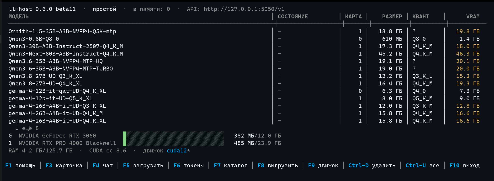

# llmhost

> Other languages: [Русский](../README.md) · [中文](README.zh.md) · [Português (BR)](README.pt-br.md)

llmhost is designed for local execution of large language models (LLMs) on your machine under Linux. Privacy and the ability to operate in an air-gapped environment are ensured. It is a wrapper around llama.cpp that, by applying optimized, automatically computed LLM launch parameters, achieves the fullest possible system resource utilization and a significant increase in LLM inference speed.

The application consists of `llmhostd`, a background service that launches models and monitors GPU memory, and `lhctl`, a TUI-based console interface used to operate the application, adjust its parameters, manage the engines the application runs on, and create and administer API access tokens. There is no graphical window by design: the service lives in the terminal, and programs interact with it over the network.

At its core the system runs stock [llama.cpp](https://github.com/ggml-org/llama.cpp) builds, without custom patches. Externally the system presents a single API address, with models called by name.



---

## Key Capabilities

- **A unified interface for LLM access.** The client is configured against the BaseURL `http://127.0.0.1:7330/v1`. The access token is configured and managed in the `lhctl` TUI. Whichever model you choose, the BaseURL and the token remain the same.
- **Several models at once.** Several models can reside in video memory simultaneously; the number depends on the amount of VRAM (video memory). By default no more than two — for example, a conversational model and a document-search model. Each request selects its model by name. If there is insufficient room for a new model, the model that has been idle the longest is unloaded; its next request brings it back.
- **Multi-GPU configuration.** A model is placed on the fastest card that can hold it in full. If that card has little free memory at load time, the next card with sufficient room is used. A model that fits no single card is split across all of them. For MoE models, experts are placed in system RAM when memory is insufficient.
- **Model catalog with guidance.** Model search is available from the `lhctl` utility (the `search` command or the catalog in full-screen mode). Before downloading, it is already visible whether a model will fit and with what maximum context. The catalog interface shows the recommended quant for the model. Resuming after a dropped connection is supported during download; a running download can be stopped on the fly (`lhctl pull stop` or `Ctrl-X` in the interface) — the partial file stays and continues on a repeat. The integrity of the downloaded file is verified with the SHA256 algorithm.
- **Automatic parameter tuning for your hardware.** Before launch, the llmhost algorithms select the context size, KV-cache compression, and the placement of a large MoE model on their own. The automatic configuration can be relied upon: as a rule, it produces optimal parameters. If desired, manual configuration can be enabled through `lhctl` by setting `auto-params = false` and overriding the remaining parameters.
- **Automatic MTP detection and attachment.** A native MTP module or built-in nextn layers (Qwen3.6, GLM) are attached automatically. `lhctl pull` downloads a matching MTP module and vision projection together with the selected quant, if they are present in the repository: among several quants of the model's MTP, the one of the same class as the base model is taken. Usage is enabled and disabled in the model card with the `mtp-mode = off/on/auto` keys.
- **Thinking control.** The model's reasoning before the answer is switched per-model: `lhctl thinking <model> auto|on|off`, the T key in the TUI model card. The mode reaches the child as the `--reasoning` flag; `auto` lets the engine decide from the chat template.
- **Smart VRAM retention.** A model that receives no requests is unloaded from video memory after 15 minutes of idle time. The retention time of a model in VRAM can be configured in the settings. An API request from an application addressed to a model places it back into video memory automatically.
- **Metrics.** `/v0/metrics` serves metrics in the Prometheus format: requests, errors, tokens, generation speed, and card memory — plus exact per-model engine telemetry (decode and prefill throughput, speculative acceptance) read straight from the running engines. See it as a table and sparkline in `lhctl metrics -w` and on the TUI metrics screen (key `m`).
- **A closed API.** Unlike the applications of other vendors, the local API requires a personal access token. A third-party program on the same computer cannot use the model silently. This is done to ensure controlled use of the machine's resources.

---

## One-Command Install

The installer fetches a static archive from GitHub Releases. The executables have no external dependencies. **No root is required and sudo is not used**: the executables are installed into `~/.local/lib/llmhost`, the `lhctl` symlink into `~/.local/bin`, the service is a systemd **user** unit, and the data resides in `~/.local/share/llmhost` — everything lives in the home directory. The system must have `curl`, `tar`, `sha256sum` and systemd for the application to be installed correctly.

**Tested distro: Ubuntu.** Development and testing are performed on Ubuntu; on other distributions full functionality is not guaranteed — it has not been tested. The static binaries carry no system library dependencies, but Ubuntu is the tested path.

```bash
curl -fsSL https://github.com/bkisonka/llmhost/releases/latest/download/install.sh | sh
```

The script asks for a model directory and shows the default path. The answer is written to the `llmhost.conf` configuration file. The directory can be set without the prompt with the `--models-dir PATH` flag. The script then verifies the integrity of the archive, installs `llmhostd`, `lhctl` and the manifest into `~/.local/lib/llmhost`, creates the `lhctl` symbolic link in `~/.local/bin` (where it lands on `PATH`), registers the systemd service, starts it, and installs the system core — llama.cpp (the "engine"). If `nvidia-smi` is present in the system, the `cuda12` release is selected; otherwise the `vulkan` llama.cpp release.

Flags: `--version TAG` (a specific release instead of the latest), `--engine cuda12|vulkan|none`, `--no-engine`, `--no-start` (leaves systemd untouched), `--models-dir PATH`. For mirrors and non-standard paths there are the variables `LLMHOST_BASE_URL`, `LLMHOST_DIR`, `LLMHOST_BIN_DIR`, `LLMHOST_MODELS_DIR`. Details: `install.sh --help`.

**Where everything is downloaded from.** The llama.cpp engine is fetched by the daemon itself — only from the official llama.cpp releases (github.com/ggml-org/llama.cpp): the URLs and SHA256 hashes are pinned in `manifest.json`, and a mismatch is a refusal. Models are downloaded from HuggingFace and verified against SHA256. There are no other network sources. **Downloading llama.cpp through the application interface is not required**: fetch a llama.cpp release from the same page and unpack it into `<data dir>/engine/cuda12/` (for Vulkan — `engine/vulkan/`) — the daemon will recognize the build as installed on its own, and `lhctl engine` will show it with a checkmark; the llama.cpp search is recursive, and the upstream layout with a version subdirectory works. The installer can also perform the installation without any engine at all (the `--no-engine` parameter). An arbitrary llama.cpp build from any location is configured with the `[general] llama-server` path key in `llmhost.conf`.

**Updating** is performed the same way as installation. The daemon stops, files are replaced, and the service is brought up again. Data, models and accumulated measurements are preserved. If the control port is non-standard, run `export LHCTL_PORT=PORT` before updating. llama.cpp itself is updated separately: `lhctl engine update`.

All data resides in `~/.local/share/llmhost`. If `$XDG_DATA_HOME` is set, in `$XDG_DATA_HOME/llmhost`. The `LH_DATA_DIR` variable overrides that location. It contains the `llmhost.conf` configuration, the `token.txt` and `api_tokens.json` keys, the engine, models, and the `log.txt` journal.

### First Run from Scratch

```bash
lhctl status                  # the service is already up (installed it)
lhctl pull qwen3              # a model: the quant is chosen for your GPUs
lhctl chat qwen3 "hello!"     # a conversation
lhctl                         # full-screen interface (registry, catalog, chat)
```

---

## Building from Source and the systemd Service

```bash
cmake -S . -B build-linux && cmake --build build-linux -j$(nproc)
LH_LOG_STDERR=1 ./build-linux/llmhostd      # run in the foreground
./build-linux/lhctl status                  # another terminal
```

**Operation as a service** (the primary method): the systemd user unit is installed by the `scripts/install-systemd.sh` script. It writes `~/.config/systemd/user/llmhostd.service` and runs `enable --now`. Then:

```bash
systemctl --user status llmhostd
systemctl --user restart llmhostd   # after editing ports in llmhost.conf
journalctl --user -u llmhostd -f    # live journal tail
loginctl enable-linger              # start with the machine, without login
```

The unit sets `Restart=always`: the daemon remains permanently under the unit's control. Even a clean termination (`lhctl quit`, SIGTERM) is treated by the unit as a failure, and the daemon is started again two seconds later. Intentional shutdown is performed only with the `systemctl --user stop llmhostd` command. Starting the binary manually via setsid or nohup is not recommended: the process escapes the unit's control.

`KillMode=control-group` means that stopping the unit terminates both the daemon and all llama-server processes. If the daemon terminates abnormally outside systemd, the orphaned processes are cleaned up on its next launch. They correspond to the `orphan:` lines in the journal.

The release archive is built by the `scripts/package_release.sh [version]` script: a static build and unit tests are performed; `dist/` receives the `llmhost-<ver>-linux-x64.tar.gz` archive, a checksum file, and the release files.

---

## lhctl: Quick Reference

`lhctl` is a console client of the control API. It uses the same key and data directory as the daemon. Without arguments in a terminal, it opens the full-screen interface.

```bash
lhctl                            full-screen interface: model registry,
                                 GPU memory, catalog, chat, tokens
lhctl status                     dashboard: VRAM bars per GPU, models;
                                 -w refreshes live
lhctl models [--raw]             model registry; --raw — ids line by line
lhctl search qwen3               search the HuggingFace catalog: size, VRAM
                                 estimate, fits your GPUs or not (→ lhctl pull)
lhctl pull qwen3                 install a model by name: the quant for your
                                 GPU is picked automatically (+mmproj and an
                                 MTP module, if present)
lhctl pull stop                  stop a running download: the partial file
                                 stays, a repeated pull resumes it
lhctl chat qwen3                 dialog in the terminal (stream, /bye — exit)
lhctl chat qwen3 "question"      one question — one answer (for scripts)
lhctl bench                      benchmark engine builds on a model
lhctl engine                     engine: manifest pin, builds, statuses
lhctl engine update              fresh llama.cpp b-release: pin + install
lhctl engine install cuda12      (re)install a build from the current pin
lhctl engine use cuda12          pick the build to run explicitly (auto — by hardware)
lhctl load Qwen3-0.6B-Q8_0       load (a registry name or a path to a .gguf)
lhctl show Qwen3-0.6B-Q8_0       model card: architecture, quant, context
lhctl ctx qwen3 32768            manual model context (auto — clear it)
lhctl set                        table of [general] keys, writes to the config
lhctl tokens add rag2            named /v1 token (rm — revoke)
lhctl rm Qwen3-0.6B-Q8_0         delete a model permanently (with satellites;
                                 asks, --yes — without asking)
lhctl image                      image generation: status and artists catalog
lhctl image pull z-image-turbo   download an artist (no name — the built-in
                                 catalog; or org/repo with recipes/ layout)
lhctl image rm flux3-klein       delete an artist from disk (a loaded one
                                 is stopped by the daemon; --yes — no asking)
lhctl image load flux3-klein     load (unload — stop; the model is reached
                                 by /v1/images/* requests on the OpenAI port)
lhctl unload [model]             unload one (or all — without a name);
                                 --force — unload a busy one forcibly:
                                 interrupts all generations of that
                                 model for all its clients
lhctl mtp qwen3 off              model speculation: auto / on / off (like lhctl ctx)
lhctl quit                       stop the daemon
```

**Full-screen interface.** Arrow keys and PgUp/PgDn select a model. `Enter` or `F3` opens the model card (`C` sets the context manually, `M` toggles the MTP mode; for a loaded model the card shows the live arguments of the child process). `F2` — detailed status of the loaded models: layers, their placement, the draft, KV. `F4` — chat; `F5` loads the model into video memory; `F7` — the catalog with search and quants; `F6` — access tokens; `F8` unloads the selected model (if it is busy generating, it offers to confirm a forced stop); `Ctrl-U` — all models at once; `F9` — the engine with live installation progress; `Ctrl-D` deletes the model from disk; `Ctrl-X` stops a running download (from any screen). On-screen data refreshes once per second. On exit, the terminal is restored to its original state.

**Autocompletion** (bash): add `source <(lhctl completion bash)` to `~/.bashrc` — afterwards, `lhctl load <TAB>` lists the identifiers from the registry.

**Key and port resolution.** The token is taken from `token.txt` in the data directory (`~/.local/share/llmhost`). The control port is 7331 by default. Both values are overridden by the `--token` and `--port` flags or the `LHCTL_TOKEN` and `LHCTL_PORT` variables. Answers are printed to stdout, errors to stderr only. Exit codes for scripts: **0** — success, **1** — server unreachable, **2** — invalid token (401), **3** — request error (404/500), **4** — argument error.

---

## Model Lifecycle: Load, Retention, Unload

- **Loading** takes seconds. The state and the occupied video memory are shown in `lhctl status` and `/v0/status`.
- **Smart VRAM retention.** If no requests reach a model for `unload-after-min` minutes (fifteen by default), it is unloaded from video memory automatically. This is transparent to the client: the first request places the model again, and the answer arrives with a delay of a few seconds. Every unload is recorded in the journal.
- **A request cancelled by the client stops the generation.** If the client drops the connection (a task is cancelled in an application, a tab is closed), the daemon notices it and kills the abandoned generation: the model does not keep chewing on a cancelled request, and the slot and its busy state are freed immediately. The event is written to the journal and counted by the `client_gone` metric (`GET /v0/metrics`).
- **Manual unload** — `lhctl unload` or the `F8` key. Memory is freed immediately, and the model choice is retained. A model busy generating is not touched without an explicit decision — the refusal comes with an explanation; `lhctl unload <model> --force` (in the TUI — confirmation via `F8`) stops the model forcibly: all of its generations are interrupted for all clients.
- On memory shortage or file damage, a record appears in the journal and the model receives the `failed` mark in the registry. If a model did not fit in full, the planner automatically lowers the parameters before launch and records exactly what was changed.

---

## Serving Multiple Models Concurrently

The daemon holds **several models simultaneously** — as many as the `models-max` key allows (2 by default; `1` — keep a single model, `0` — no limit) and as many as fit in video memory. The parameters of each model are computed separately.

- **Loading a second model — both remain in memory.** The states are visible in `lhctl status` and `lhctl models`.
- **When memory is insufficient, the idle model that has been unused the longest is unloaded.** The event is recorded in the journal. The unloaded model is raised again automatically by its next request.
- **Model selection by every request.** In an OpenAI request this is the `model` field. The list of names is returned by `GET /v1/models` and `lhctl models --raw`. If the field is empty, the last loaded model answers.
- **Parallel requests.** A single model can serve several clients concurrently. The `parallel` key (1 by default) sets the number of threads. The model's context is divided evenly between them, and the memory budget is recomputed so that everything fits.
- **Embedding models.** Families such as BERT (nomic-embed, bge, e5, gte) are recognized by architecture; requests are served through `/v1/embeddings`. They do not take part in chats.

---

## Daemon Orchestration (harness)

The daemon's mode of operation is harness: decisions about which model to load, onto which card, and when are made by the daemon, not the engine. Each model in video memory runs as a **separate** llama-server process. The proxy dispatches requests by the `model` field.

This is due to the internal implementation of the llama.cpp router changing from release to release, which required re-verifying engine behavior on every update. In harness, the engine is replaced without any change to the daemon's logic: placement plans, eviction, speculation, vision, and manual context.

Rules for multiple users:

- **A busy model is not evicted.** While generation is running, the model's slot is not touched regardless of the request source. `lhctl unload` and `POST /v0/unload` for a busy model return a refusal with an explanation. There is one explicit hatch: `POST /v0/unload` with `"force": true` (or `lhctl unload <model> --force`) unloads the model forcibly, interrupting all of its generations for all clients.
- **When memory is insufficient, only unoccupied models are evicted.** If a new model lacks memory, the daemon automatically unloads idle models and loads the new one.
- **If memory is held by busy models, the request waits.** It is placed in a queue and executed after the neighboring model is released and unloaded. If `queue-ttl` seconds (120 by default) are exceeded, the client receives a 504 with an explanation instead of a sequence of non-obvious errors. The number of requests that may wait for one model is set by `queue-depth` (16 by default). The queue is observed in the `llmhost_queue_depth`, `llmhost_queue_wait_ms` and `llmhost_queue_timeouts_total` metrics on `GET /v0/metrics`.
- **After a daemon restart the models are restored.** The list of models that were in video memory is saved in `state.json`.

Keys: `queue-ttl` (a zero value disables waiting: on a busy model, an immediate refusal with an explanation) and `queue-depth`. Both apply without a restart.

---

## Multi-GPU Configurations

The service detects all cards through NVML and places models automatically.

A model's primary card is the fastest one on which it fits in full. Cards are sorted by computational power: compute capability first, and on a tie, by memory size. Cards that the model does not fit on even in full are excluded from the allocation.

If the primary card lacks free memory at load time, the next card with sufficient capacity is used. Manual `main-gpu` and `tensor-split` take priority over this choice.

A model that fits no single card is distributed across the entire pool. A dense model larger than the **total capacity of the pool** operates in hybrid mode: layers are spread across the cards proportionally to memory, and the remaining part (the tail) is placed in system RAM. For MoE models, the experts are moved to system RAM in full. Before a heavy model is loaded, idle models are unloaded automatically if the plan shows insufficient room.

- The fit estimate is computed for the card the model is targeted at. The memory of each card is shown by `lhctl status` and `GET /v0/status` (the `gpus` array). `lhctl models` indicates the card for each model. A value of −1 means distribution across all cards.
- Manual pinning is the `main-gpu` key in the model's `llmhost.conf` section. It is a preference: if the model does not fit in full on the named card but fits on another, the daemon moves it and records in the journal: "card N pin does not hold — whole onto card M".
- `tensor-split` sets the per-card shares explicitly and is executed as specified. The same key sets partial layer offload on a card with a small amount of memory, for example `main-gpu = 0` and `tensor-split = 1,0`. On CPU-bound decoding, speculation yields the largest gain (see the section below).
- Two models can be pinned to one card. Concurrent operation is possible only if both fit; otherwise the first remains in memory and the second receives the `failed` mark. There is no automatic eviction by room in this case.
- The engine is started with `CUDA_DEVICE_ORDER=PCI_BUS_ID`. Without it, CUDA numbers the cards by speed, and a pin may land on a different card.

On a test bench with two cards (a 3060 with 12 GiB and an RTX PRO 4000 Blackwell with 24 GiB, measured 02.10.2026), Qwen3.8-27B Q4_K_XL delivered 23 tok/s in split mode and 36 tok/s with a native MTP module. A 30B-A3B MoE with experts in system RAM delivered 26 tok/s. The catalog estimates fit by the total capacity of all cards.

---

## Adding and Removing Models

The model catalog is a plain directory (`models-dir`). llmhost monitors it automatically.

- **Placing a `.gguf` file into the directory** (manual download or copying from another computer): within a few seconds the model appears in the registry and in the API list. No restart is required, and loaded models are unaffected. A llama.cpp file group such as `…-00001-of-00004.gguf` is one model, not a separate entry per part.
- **Deleting a file manually** — the model likewise disappears from the registry.
- **`lhctl rm`** (or `Ctrl-D` in the full-screen interface) deletes a model together with its satellites: the vision projection, the MTP module, and all parts of the group. On a server without a graphical environment there is no recycle bin — deletion is performed immediately and irreversibly. The command asks for confirmation; the `--yes` flag disables it as well. A model currently in video memory is unloaded automatically before deletion.

---

## Images: the Artists Catalog

Picture generation is served by a second engine (sd-server); it has its own model catalog: `diffusion_models/`, `text_encoders/`, `vae/`, recipes `recipes/*.json`, and bindings `llmhost-image.json`. One download mechanism for all of the application's models:

- **`lhctl image pull <name>`** — download an artist from the built-in catalog (without a name — the list): the entries are matched to real HuggingFace repositories (diffusion and encoder quants at unsloth, VAE in the comfy repositories of the originals), SHA256 is verified, interrupted downloads resume. Files land in their categories, the binding and the recipe are written automatically — the model is immediately visible in `lhctl image` and in the `/v1/images/models` selector.
- **Your own source** — an `org/repo` repository with the convention layout: exactly one `recipes/*.json` (sd-server format) and one file each in `diffusion_models/` (`.gguf`), `text_encoders/` (`.gguf`) and `vae/`.
- **`lhctl image rm <name>`** — delete an artist from disk: slot files, the free recipe, and the binding record; a loaded model is stopped by the daemon itself. Confirmation is requested; `--yes` disables it.

Image editing (`/v1/images/edits`) is available only to models whose recipe declares the `ref_images` feature in `features` (the engine reads this recipe field itself: if it is not declared, the capability is considered unsupported). A request to a model without the feature receives an honest `400` with a hint, and the engine is not woken.

---

## Per-Model Overrides

Automatic tuning produces the optimal result in most cases. When individual values are required, a section for the model is created in the same `llmhost.conf`. The section header is the file name without `.gguf`. Changes take effect within a few seconds; no restart is needed:

```ini
[Qwen3.8-27B-UD-Q4_K_XL]
main-gpu = 1
cache-type = q8_0
ctx-size = 65536
system = You are a duty assistant. Answer briefly.
```

A comment is a whole line starting with `#` or `;`. The legacy `model_overrides.json` is read only if `llmhost.conf` does not exist.

| Key | Meaning |
|------|-------|
| `ctx-size` | the model's total context (split between `parallel` threads) |
| `n-gpu-layers` | how many layers on the GPU (0 — as the planner computed) |
| `main-gpu` | pin to a card (0, 1, …); −1 or empty — auto |
| `tensor-split` | split proportions per card, e.g. `0,1` — everything to card 1 |
| `cache-type` | KV cache: `f16` / `q8_0` / `q4_0` |
| `mtp-mode` | this model's speculation: `on` / `off` — deterministic, on top of the watchdog and heads; `auto` — the global key decides (clears the override) |
| `system` | system prompt for clients that did not send their own |
| `model-draft` | draft model for speculation (id/name/path) |
| `spec-type` | `draft-simple` (default), `draft-mtp`, `eagle3`, `ngram-*` |
| `draft-card` | `spare` — file-based `draft-simple` on the spare card (harness; an MTP draft must live with the trunk — shared KV graph, moving it breaks the load). The point is to free the trunk's VRAM; the draft's speed on a weaker card is usually lower |
| `expert-card` | `spare` — part of the MoE expert blocks on the spare card with full `exps=CPU` offload (harness; the partial `n-cpu-moe` shape is not touched) |

**Speculation.** For models with built-in MTP (Qwen3.6/3.5, GLM-4.5 and similar), the speed-up is enabled without any keys. The `nextn_predict_layers` marker is read from the GGUF, and speculation operates in the `draft-mtp` mode.

If a model has a native MTP module in the `MTP/` subfolder of its Hugging Face repository, `lhctl pull` downloads the quant-matched file together with the model, and at load time it is attached automatically. If the module did not fit, the load is retried without speculation. The switch-off is `mtp-mode = off` in `[general]`. An incompatible pair refuses to load and reports the reason.

The draft can be any variant: an MTP module, a smaller model of the same family, or a manually specified pair. It is always placed in video memory **in full**, including its own layers and the output layer. The number of main-model layers that fit on the GPU has no effect on the draft.

This matters substantially under partial offload. Measurement of 06.10: a 27B model on a 12 GiB card (24 of 65 layers on the GPU, decode CPU-bound) delivered 3.6 tok/s without speculation and 8.3 with an MTP module (×2.3). A 30B MoE with experts in system RAM and the manual pair `model-draft = Qwen3-0.6B-Q8_0` accelerated from 29.8 to 37.2 tok/s (×1.25). If no native MTP is available, a manual pair from the same family with a shared tokenizer is suitable: `model-draft` and `spec-type = draft-simple`.

**Draft-acceptance watchdog.** The share of accepted drafts varies from request to request — even on a single model it ranges from 0.64 to 0.98. On an unlucky trajectory, speculation may turn out slower than plain generation.

The daemon reads the statistics from the process journal. A window is counted over the sum of the accepted and generated counters. If acceptance remains below `draft-accept-floor` for three consecutive windows and each window gathered at least `draft-accept-min-tokens` drafts, the automatic draft is disabled. The model is restarted without speculation — until the daemon is restarted. The decision is made only while idle and only when a single model is in video memory. A manual `model-draft` is not disabled; a warning is written to the journal.

The exception is Qwen3.8-Flash-Next: the acceptance of its native MTP head on live text is a steady 0.32–0.41 across all five checked conversions (the quant and the source of the head do not affect acceptance), so the watchdog withdraws the draft itself, and the model operates faster without speculation.

---

## Planner Adaptation and VRAM Headroom

The analytical fit estimate is approximate: the error is on the order of a gigabyte due to MoE workspaces, hybrid architectures, and NVFP4. The daemon therefore **adapts on actual loads**.

After every successful load, it measures the model's actual footprint in video memory through NVML and records the overhead beyond the weights and the KV cache into `model_profiles.json`. Each launch shape has its own slot: the output layer on the card or in system RAM, the cache type, ubatch, the engine class, experts in system RAM, and the layer count under split. The profile scales to a different context. The next load is already planned from it.

If the analytics rejects the output layer, the daemon attempts to place it in the running system. On memory shortage, a restart without it is performed and the failure is remembered. These are the `profiles:` lines in the journal. The profiles file can be deleted — the planner will start adapting anew.

When planning a model into memory, the daemon keeps a **1.5 GiB headroom** on the card. The built-in fit probe of llama.cpp is disabled (`fit = off`), and this headroom replaces it. It covers the initialization of CUDA contexts on neighboring cards: the library initializes every visible card, and on a nearly full one this makes launching unreliable. The same headroom covers vision-encoding peaks. The context budget includes the entire load: the vision projection and the draft are placed on the card together with the weights.

For MoE, the expert volume is read exactly, from the GGUF tensor list. Tensors with "exps" in their name are summed, not "a percentage of the file". The "will system RAM hold it" threshold and the budget of the part remaining on the card depend on this.

For partial expert placement, the list is read by blocks. In some families the first blocks are dense, and an "evenly per layer" division would overstate the offload volume. The offload is executed with the engine's native `--n-cpu-moe` flag.

The "experts in system RAM" shapes, partial expert placement, and partial split of dense models are profiled as well. Their footprint consists of two parts: video memory by measurement and system RAM by the known file bytes.

---

## Automatic Parameter Tuning

The feature is enabled by default (`auto-params = true`). Before each model launch, llmhost performs the following.

- Sets the **context** to the largest possible for this model and your cards, rather than a fixed minimum. For modern models this is tens of thousands of tokens. SWA windows are read from the GGUF metadata: in gemma-4, the local layers do not reduce the context of the global layers.
- **Compresses the KV cache** to `q8_0`, but only if an uncompressed cache would not allow a reasonable context to fit. On small models, compression would reduce speed by a few percent without benefit. If the context is set manually (`ctx-size`) and the uncompressed cache fits it, compression is not enabled: on f16, decoding is faster and quality is higher.
- For **MoE models with limited memory**, partial expert placement is checked first. The first few blocks are moved to system RAM, and the remaining experts stay on the card. Every block kept on the card saves its exchange with system RAM on every token. If the variant does not fit, or system RAM is insufficient, the experts are moved in full.
- **Takes the model's read source into account.** From a local disk — as usual, with lazy paging. If the model resides on a network disk, llmhost reads the file sequentially into the page cache once after startup: otherwise the first minutes of generation would stall on cold pages.

Every choice is visible in `/v0/status` (the `auto` block) and in the journal. If the automation is not needed, set `auto-params = false`: the plan is built without the automatic steps (KV q8, experts in RAM, warm-up), and `ngl` is taken from the manual setting. The semantics of `ctx` in `[general]` is **the plan's floor**, not an exact pin: the planner will not drop the context below this value, but it will not shrink a model that fits within its maximum either (in practice: `ctx = 8192` with `auto-params = false` still yields 40960 for qwen3-0.6B). An exact manual context is the per-model `lhctl ctx <model> <n>` (the `ctx-size` section): it sets the planner's budget and works as a lower bound; it cannot cap a model from above.

Video memory data on NVIDIA cards is taken from NVML; free VRAM matches `nvidia-smi` within telemetry error.

---

## Connecting Client Applications

An application with OpenAI API support requires three parameters.

> **The full API contract** — ports, key, endpoints, error shape and compatibility guarantees — is in [API.md](API.md). A quick contract check on a live server: `python3 tests/api_e2e.py --quick`. The comparison with Ollama — [vs-ollama.md](vs-ollama.md). The measurements are reproduced by the `bench_vs_ollama_linux.py` script.

- **Address (base URL):** `http://127.0.0.1:7330/v1`
- **API key:** the contents of `token.txt` in the data directory. The same key is shown by `GET http://127.0.0.1:7331/v0/credentials`.
- **Model name:** a concrete name from `GET /v1/models`, for example `Qwen3-0.6B-Q8_0`. If omitted, the last loaded model answers.

A check from the command line:

```bash
TOKEN=$(cat ~/.local/share/llmhost/token.txt)
curl http://127.0.0.1:7330/v1/chat/completions -H "Authorization: Bearer $TOKEN" \
     -H "Content-Type: application/json" \
     -d '{"model":"any","messages":[{"role":"user","content":"Hi!"}]}'
```

The same operations through `lhctl` — the token and port are determined automatically:

```bash
lhctl status
lhctl models --raw
lhctl load Qwen3-0.6B-Q8_0
```

For scripts there is the control API on port `7331`, with the same key. State — `/v0/status`, the model list — `/v0/models`, load and unload — `/v0/load` and `/v0/unload`, catalog and download — `/v0/catalog/search`, `/v0/catalog/model`, `/v0/pull` (start, status, and stop via `DELETE`), engine benchmark — `/v0/bench`, the key — `/v0/credentials`, metrics — `/v0/metrics`, shutdown — `/v0/quit`.

Private Hugging Face repositories: place your token into the `HF_TOKEN` variable before starting the daemon.

**Security.** By default both APIs listen on `127.0.0.1` and require a Bearer key. The `token.txt` file is created automatically with 0600 permissions, and the key is cryptographically random. Browser clients are granted CORS only from `localhost` and `127.0.0.1`. An external frontend is added to `cors-origins`.

**Service on a local network:** `openai-bind = 0.0.0.0` and `openai-port = 5050` in `[general]`. The OpenAI port listens on all interfaces. A Bearer key is enforced in that case: there is no open API without a key. The control API always remains on localhost.

---

## Settings: llmhost.conf

The single configuration file is `llmhost.conf` in the data directory, INI format. The `[general]` section holds the general settings; the remaining sections are per-model overrides (described above). The file is edited by hand, via `lhctl set`, or via the API (`GET` and `POST /v0/settings`). The daemon's commands write their values here as well: `lhctl ctx`, `lhctl engine use` and `lhctl engine update`.

Most keys apply **on the fly**. The file watcher rebuilds the preset and gracefully restarts the child processes within seconds. The ports, `openai-bind`, `openai-auth` and `cors-origins` take effect after `systemctl --user restart llmhostd`.

```ini
[general]
models-dir = /data/models
ctx = 4096
```

The main `[general]` keys. The full table — `lhctl set` and [CLI-linux.md](CLI-linux.md), section 6.

| Key | Default | Meaning |
|------|-----------|-------|
| `openai-port` | 7330 | OpenAI proxy port (restart) |
| `control-port` | 7331 | control API and lhctl port (restart) |
| `openai-bind` | 127.0.0.1 | `"0.0.0.0"` — service on the LAN; Bearer is then mandatory (restart) |
| `openai-auth` | true | require a Bearer key on :7330 (restart) |
| `cors-origins` | — | trusted CORS origins, comma-separated (restart) |
| `queue-ttl` | 120 | how long a request waits in the queue, seconds; 0 — do not wait |
| `queue-depth` | 16 | how many requests may wait for one model at most |
| `models-max` | 2 | how many models to keep in GPU memory (0 — no limit, extras leave by age) |
| `parallel` | 1 | concurrent requests per model (the context is split between them) |
| `auto-params` | true | smart tuning: as much context as fits, KV q8_0, card layout |
| `ctx` / `ngl` | 4096 / 999 | manual context and GPU layers (with `auto-params: false`) |
| `ubatch` | 0 | llama-server physical batch; 0 — engine default |
| `unload-after-min` | 15 | idle minutes before unload; 0 — never |
| `gpu-pin` | true | land the model on the fastest card it fits whole; if memory is short there — the next one |
| `auto-draft` / `mtp-mode` | true / auto | speculation: a junior family model or an MTP module (`auto\|on\|off`) |
| `draft-accept-floor` | 0.5 | if draft acceptance stays below this for three windows in a row, the auto-draft is switched off and the model reloads without it; 0 — disable the watchdog |
| `draft-accept-min-tokens` | 1000 | the watchdog ignores windows shorter than this many drafts |
| `models-dir` | `<data>/models` | GGUF model directory |
| `engine-build` | — | engine build (`cuda12` or `vulkan`); empty — by hardware |
| `engine-release` | — | pinned engine release (`b11476` in the shipped manifest); written by `lhctl engine update` |
| `llama-server` | — | path to llama-server; empty — from the installed engine |
| `moe-cache-mib` | 0 | hot MoE expert cache in GPU memory: `0` — off, `N` — size in MiB, `-1` — the planner picks it. The budget is accounted by the plan: a tight model gets less, no overflow |
| `extra-args` | — | verbatim extra flags for every llama-server, space-separated (for experimental builds and flags not yet in a stable release); the flags mean whatever the engine you run says |
| `lang` | auto | UI language: `auto` — by the machine locale (Russian → Russian, any other → English), `ru`/`en` — force; applies on the fly (lhctl/TUI and the daemon's client-facing replies) |

### Rolling Back an Experimental Engine

If a model runs on a third-party engine build (the `llama-server` key points to it and `extra-args` carries its flags) and something goes wrong — returning to the stock release takes seconds and requires no reinstallation:

```ini
[general]
llama-server =
moe-cache-mib = 0
extra-args =
```

The watcher applies the keys on the fly, and the next request to the model brings it up on the engine from the installed release. The third-party build resides in a separate directory and does not interfere with `lhctl engine update`; after a stock engine update that has absorbed the needed capabilities, the third-party build and the extra flags can simply be deleted.

The working state (`last_model`, `mtp_choices`) is stored separately, in `state.json`. It has no place in the configuration file. Installations with the legacy `config.json` are migrated automatically on the first start of the new daemon.

---

## Metrics for Prometheus

`GET /v0/metrics` on the control API, behind the same Bearer token, returns text in the Prometheus format: requests, bytes and errors per model, tokens from the usage of responses, durations, the smoothed speed in tokens per second, card VRAM, and live model states.

The scraper is configured in `prometheus.yml` with a `bearer_token`. For clients on a local network this is the primary observation point, instead of searching `log.txt`.

---

## Troubleshooting

- **Journals.** `journalctl --user -u llmhostd -f` and `log.txt` in the data directory (1 MiB rotation). A problem report uses this information first of all: versions, parameter choices, refusal reasons, evictions, and the `orphan:` lines.
- **"Port busy".** Ports 7330 or 7331 are already occupied by another process. Change the port in `llmhost.conf` and run `systemctl --user restart llmhostd`.
- **The model "does not fit".** Choose a lighter quant in the catalog — the variants are sorted ascending — or a smaller model. Each variant states the required amount of video memory.
- **"Repository not found, private, or a token is required".** The repository is private. Obtain a free token at huggingface.co and set `HF_TOKEN`.
- **"The second daemon does not start".** The daemon is already running: one instance per data directory, enforced by a pid lock.
- **The engine is "not the one" after an application update.** The pinned version is stored in `engine-release` and survives updates. The divergence between intent and fact is visible in `lhctl engine status`: the `installed_release` and `mismatch` fields.

---

## Documentation

- [CLI-linux.md](CLI-linux.md) — a practical reference: full-screen mode, all lhctl commands, curl examples for the control API, the config, diagnostics.
- [API.md](API.md) — the full contract of the OpenAI-compatible API and the control API.
- [vs-ollama.md](vs-ollama.md) — measurements and the comparison with Ollama.
- [RELEASE_NOTES.txt](../RELEASE_NOTES.txt) — what is new in the current release.

---

## License

Proprietary. The full text is in [LICENSE](../LICENSE) (v1.2). Personal non-commercial use and code modification are allowed without agreement with the author, exclusively for personal application; when a modification is published, its origin must be stated explicitly — passing it off as the original is not permitted, and private edits on your own devices create no obligations. Copying, distribution, publication, and business use — only with the prior written permission of the copyright holder (github.com/bkisonka). Releases up to and including v0.6.0-beta11 were distributed under the dual GNU GPL (v2 — personal, v3 — business); received copies remain under its terms. The llama.cpp engine is MIT (github.com/ggml-org/llama.cpp). It is not part of the distribution: it is downloaded separately on first run and remains under its own license. The Russian text of the license is the binding one.
