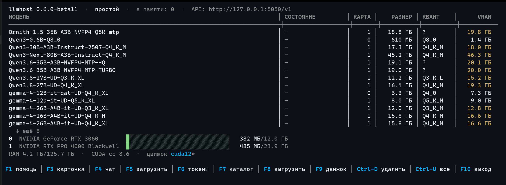

# llmhost

> Outros idiomas: [Русский](../README.md) · [English](README.en.md) · [中文](README.zh.md)

O llmhost destina-se à execução local de grandes modelos de linguagem (LLM) na sua máquina, sob o sistema operacional Linux. São garantidos a privacidade e a possibilidade de operação em ambiente autônomo: a conversa não sai da máquina — nem para a nuvem, nem para a API de terceiros. Trata-se de um wrapper sobre o llama.cpp que, utilizando parâmetros de execução otimizados e calculados automaticamente, permite alcançar a mais completa utilização dos recursos do sistema e aumentar significativamente a velocidade de inferência dos LLM.

O aplicativo é composto pelo `llmhostd` — um serviço em segundo plano que executa os modelos e monitora a memória das placas de vídeo — e pelo `lhctl` — uma interface de console baseada em TUI que permite gerenciar a operação do aplicativo, alterar seus parâmetros, gerenciar os motores em que o aplicativo opera, bem como criar e gerenciar os tokens de acesso à API do aplicativo. Qualquer aplicativo que fale com a OpenAI API conecta-se a ele e recebe respostas — um chat, um editor de código ou o seu script.

Não há interface gráfica — isso é proposital: o serviço vive no terminal, e os aplicativos comunicam-se com ele pela rede.

Como núcleo do sistema são utilizadas builds convencionais do [llama.cpp](https://github.com/ggml-org/llama.cpp), sem patches próprios. Por fora, é simples: **um endereço de API, modelos chamados pelo nome**.



---

## Principais recursos

- **Interface única de acesso aos LLM.** O cliente é configurado contra o BaseURL `http://127.0.0.1:7330/v1`. O token de acesso é definido e gerenciado na TUI do `lhctl`. Qualquer modelo que você escolha, o BaseURL e o token permanecem os mesmos.
- **Vários modelos ao mesmo tempo.** Vários modelos podem residir simultaneamente na memória de vídeo. A quantidade depende do tamanho da VRAM (memória de vídeo). Por padrão, no máximo dois: por exemplo, um modelo de conversa e um modelo para busca em documentos. A requisição escolhe o modelo pelo nome. Se não houver espaço para um novo modelo, é descarregado aquele com o maior tempo sem uso. A próxima requisição a ele o carregará novamente.
- **Configuração multi-GPU.** O modelo é colocado na placa mais rápida em que couber inteiramente. Se, no momento do carregamento, houver pouca memória livre nessa placa, utiliza-se a seguinte com espaço suficiente. Um modelo que não couber em nenhuma placa é dividido entre todas. Em modelos MoE, os especialistas são colocados na memória RAM quando não há espaço.
- **Catálogo de modelos com sugestões.** A busca de modelos está disponível no utilitário `lhctl` (comando `search` ou catálogo em modo tela cheia). Antes mesmo do download, já se vê se o modelo caberá e com qual contexto máximo. A interface do catálogo indica o quant recomendado do modelo. Em caso de queda de conexão, o download é retomado de onde parou; um download em andamento pode ser interrompido na hora (`lhctl pull stop` ou `Ctrl-X` na interface) — o arquivo parcial fica no disco e continua numa nova tentativa. A integridade do arquivo baixado é verificada pelo algoritmo SHA256.
- **Ajuste automático de parâmetros para o seu hardware.** Antes da execução, os algoritmos do llmhost escolhem sozinhos o tamanho do contexto, a compressão do cache KV e como acomodar um modelo MoE grande. É possível confiar na configuração automática: em regra, ela produz parâmetros ótimos. Se preferir, é possível ativar o modo de configuração manual por meio do `lhctl`, definindo o parâmetro `auto-params = false` e sobrescrevendo os demais parâmetros.
- **Detecção e conexão automáticas do MTP.** O módulo MTP nativo ou as camadas nextn embutidas (Qwen3.6, GLM) são conectados automaticamente. O `lhctl pull` baixa, junto com o quant escolhido, o módulo MTP e a projeção de visão (vision) compatíveis, se existirem no repositório: entre vários quants do modelo, o MTP escolhido é da mesma classe do modelo principal. O uso é ativado/desativado no cartão do modelo pela chave `mtp-mode = off/on/auto`.
- **Controle de thinking.** O raciocínio do modelo antes da resposta é alternado por modelo: `lhctl thinking <modelo> auto|on|off`, tecla T no cartão do TUI. O modo chega ao processo filho como a flag `--reasoning`; no `auto`, o próprio motor decide pelo template.
- **Retenção inteligente de VRAM.** Um modelo sem requisições é descarregado da memória de vídeo após 15 minutos de inatividade. O tempo de retenção do modelo na VRAM pode ser definido nas configurações. Uma requisição de um aplicativo, via API, direcionada ao modelo o coloca automaticamente na memória de vídeo.
- **Métricas.** `/v0/metrics` serve métricas no formato Prometheus: requisições, erros, tokens, velocidade de geração, memória das placas — além de telemetria exata por modelo (throughput de decodificação e pré-preenchimento, aceitação especulativa) lida diretamente dos motores em execução. Veja em tabela e sparkline no `lhctl metrics -w` e na tela de métricas do TUI (tecla `m`).
- **API fechado.** A API local, ao contrário dos aplicativos de outros fornecedores, exige um token de acesso pessoal. Um programa estranho no mesmo computador não poderá usar o modelo silenciosamente. Isso foi feito com o objetivo de uso controlado dos recursos da máquina.

---

## Instalação em um comando

O instalador obtém o arquivo estático do GitHub Releases. Os executáveis não possuem dependências externas. **Root não é necessário e o sudo não é utilizado**: os executáveis são instalados em `~/.local/lib/llmhost`, o link simbólico `lhctl` em `~/.local/bin`, o serviço é uma unidade **de usuário** do systemd, os dados ficam em `~/.local/share/llmhost` — tudo reside no diretório home. Para a correta instalação do aplicativo, o sistema deve ter `curl`, `tar`, `sha256sum` e systemd.

**Distribuição: Ubuntu.** O desenvolvimento e os testes são realizados no Ubuntu; em outras distribuições, o pleno funcionamento não é garantido — não foi testado. Os binários estáticos não dependem de bibliotecas do sistema, mas o caminho testado é o Ubuntu.

```bash
curl -fsSL https://github.com/bkisonka/llmhost/releases/latest/download/install.sh | sh
```

O script pergunta o diretório de modelos e mostra o caminho padrão. A resposta é gravada no arquivo de configuração `llmhost.conf`. É possível definir o diretório sem pergunta com a flag `--models-dir CAMINHO`. Em seguida, o script verifica a integridade do arquivo, instala o `llmhostd`, o `lhctl` e o manifesto em `~/.local/lib/llmhost`, cria o link simbólico `lhctl` em `~/.local/bin` (que entra no `PATH`), registra o serviço systemd, o inicia e instala o núcleo do sistema — llama.cpp (o "motor"). Se houver `nvidia-smi` no sistema, será escolhido o release `cuda12`; caso contrário, o release llama.cpp para `vulkan`.

Flags: `--version TAG` (um release específico em vez do mais recente), `--engine cuda12|vulkan|none`, `--no-engine`, `--no-start` (não alterar o systemd), `--models-dir CAMINHO`. Para espelhos e caminhos não padrão, existem as variáveis `LLMHOST_BASE_URL`, `LLMHOST_DIR`, `LLMHOST_BIN_DIR`, `LLMHOST_MODELS_DIR`. Detalhes: `install.sh --help`.

**Origem dos downloads.** O motor llama.cpp é baixado pelo próprio daemon — apenas dos releases oficiais do llama.cpp (github.com/ggml-org/llama.cpp): os endereços e os SHA256 estão fixados no `manifest.json`; qualquer divergência implica recusa. Os modelos vêm do HuggingFace, com verificação SHA256. Não há outras fontes de rede. **Não é obrigatório baixar o llama.cpp pela interface do aplicativo**: baixe um release do llama.cpp na mesma página e descompacte-o em `<diretório de dados>/engine/cuda12/` (para Vulkan — `engine/vulkan/`) — o próprio daemon reconhecerá a build como instalada, e o `lhctl engine` a exibirá com um visto; a busca pelo llama.cpp é recursiva, e o layout oficial com subdiretório de versão é aceito. O instalador também pode realizar a instalação sem motor algum (parâmetro `--no-engine`). Um llama.cpp arbitrário, de qualquer origem — pela chave `[general] llama-server` com o caminho, no `llmhost.conf`.

**Atualização** — realiza-se de forma análoga à instalação. O daemon é interrompido, os arquivos são substituídos e o serviço é reiniciado. Os dados, os modelos e as medições acumuladas são preservados. Se a porta de controle não for a padrão, execute `export LHCTL_PORT=PORTA` antes de atualizar. O próprio llama.cpp é atualizado separadamente: `lhctl engine update`.

Todos os dados ficam em `~/.local/share/llmhost`. Se `$XDG_DATA_HOME` estiver definido, em `$XDG_DATA_HOME/llmhost`. A variável `LH_DATA_DIR` redefine esse local. Ali ficam o arquivo de configuração `llmhost.conf`, as chaves `token.txt` e `api_tokens.json`, o motor, os modelos e o log `log.txt`.

### Primeira execução do zero

```bash
lhctl status                  # o serviço já está de pé (o instalador o subiu)
lhctl pull qwen3              # um modelo: o quant é escolhido para as suas placas
lhctl chat qwen3 "olá!"       # uma conversa
lhctl                         # interface em tela cheia (registro, catálogo, chat)
```

---

## Compilação a partir do código-fonte e serviço systemd

```bash
cmake -S . -B build-linux && cmake --build build-linux -j$(nproc)
LH_LOG_STDERR=1 ./build-linux/llmhostd      # executar em primeiro plano
./build-linux/lhctl status                  # outro terminal
```

**Execução como serviço** (o modo principal): a instalação da unidade de usuário do systemd é realizada pelo script `scripts/install-systemd.sh`. Ele grava `~/.config/systemd/user/llmhostd.service` e executa `enable --now`. Em seguida:

```bash
systemctl --user status llmhostd
systemctl --user restart llmhostd   # após mudar portas no llmhost.conf
journalctl --user -u llmhostd -f    # cauda do diário em tempo real
loginctl enable-linger              # subir com a máquina, sem login
```

A unidade tem `Restart=always`: o daemon permanece constantemente sob o controle da unidade. Mesmo um encerramento correto (`lhctl quit`, SIGTERM) é tratado pela unidade como uma falha, e após dois segundos o daemon é iniciado novamente. A interrupção intencional é realizada apenas com o comando `systemctl --user stop llmhostd`. Não é recomendável iniciar o binário manualmente por meio de setsid ou nohup: o processo sai do controle da unidade.

`KillMode=control-group` significa que a interrupção da unidade encerra tanto o daemon quanto todos os processos llama-server. Se o daemon falhar de forma abrupta fora do systemd, os processos órfãos são eliminados em sua próxima execução. No log, eles correspondem às linhas `orphan:`.

O arquivo de release é montado pelo script `scripts/package_release.sh [versão]`: é executada uma compilação estática e os testes unitários; em `dist/` são criados o arquivo `llmhost-<ver>-linux-x64.tar.gz`, um arquivo com checksum e os arquivos para o release.

---

## lhctl: referência rápida

O `lhctl` é o cliente de console da control API. A chave e o diretório de dados coincidem com os utilizados pelo daemon. Sem argumentos, no terminal, abre-se a interface em tela cheia.

```bash
lhctl                            interface em tela cheia: registro de modelos,
                                 memória das placas, catálogo, chat, tokens
lhctl status                     painel: barras de VRAM por placa, modelos;
                                 -w atualiza ao vivo
lhctl models [--raw]             registro de modelos; --raw — ids linha a linha
lhctl search qwen3               busca no catálogo do HuggingFace: tamanho,
                                 estimativa de VRAM, cabe nas suas placas? (→ lhctl pull)
lhctl pull qwen3                 instalar modelo pelo nome: o quant para a sua
                                 placa é escolhido sozinho (+mmproj e módulo MTP,
                                 se houver)
lhctl pull stop                  interromper um download em andamento: o arquivo
                                 parcial fica no disco, um novo pull o retoma
lhctl chat qwen3                 diálogo no terminal (stream, /bye — sair)
lhctl chat qwen3 "pergunta"      uma pergunta — uma resposta (para scripts)
lhctl bench                      medir builds do motor em um modelo
lhctl engine                     motor: pin do manifesto, builds, status
lhctl engine update              b-release novo do llama.cpp: pin + instalação
lhctl engine install cuda12      (re)instalar build do pin atual
lhctl engine use cuda12          escolher explicitamente a build de execução (auto — pelo hardware)
lhctl load Qwen3-0.6B-Q8_0       carregar (nome do registro ou caminho de um .gguf)
lhctl show Qwen3-0.6B-Q8_0       cartão do modelo: arquitetura, quant, contexto
lhctl ctx qwen3 32768            contexto manual do modelo (auto — remover)
lhctl set                        tabela de chaves [general], grava no config
lhctl tokens add rag2            token /v1 nomeado (rm — revogar)
lhctl rm Qwen3-0.6B-Q8_0         apagar modelo para sempre (com satélites;
                                 pergunta, --yes — sem pergunta)
lhctl image                      geração de imagens: status e catálogo de artistas
lhctl image pull z-image-turbo   baixar um artista (sem nome — catálogo embutido;
                                 ou org/repo com layout recipes/ + categorias)
lhctl image rm flux3-klein       remover um artista do disco (um carregado
                                 é parado pelo daemon; --yes — sem perguntar)
lhctl image load flux3-klein     carregar (unload — parar; o modelo é acessado
                                 por requisições /v1/images/* da porta OpenAI)
lhctl unload [modelo]            descarregar um (ou todos — sem nome);
                                 --force — descarregar à força um ocupado:
                                 interrompe todas as gerações do modelo
                                 para todos os seus clientes
lhctl mtp qwen3 off              especulação do modelo: auto / on / off (como lhctl ctx)
lhctl quit                       encerrar o daemon
```

**Interface em tela cheia.** Setas e PgUp/PgDn escolhem o modelo. `Enter` ou `F3` abre o cartão (`C` define o contexto à mão, `M` alterna o modo mtp; para um modelo carregado, o cartão mostra os argumentos vivos do processo filho). `F2` — status detalhado dos modelos carregados: camadas, onde estão, draft, KV. `F4` — chat, `F5` carrega o modelo na memória de vídeo, `F7` — catálogo com busca e quants, `F6` — tokens de acesso, `F8` descarrega o modelo selecionado (se ele estiver ocupado com geração, oferece confirmar a parada forçada), `Ctrl-U` — todos de uma vez, `F9` — motor com progresso de instalação ao vivo, `Ctrl-D` apaga o modelo do disco, `Ctrl-X` interrompe um download em andamento (em qualquer tela). Os dados da tela se atualizam a cada segundo. Ao sair, o terminal volta ao estado original.

**Autocompletar** (bash): adicione `source <(lhctl completion bash)` ao `~/.bashrc` — depois disso, `lhctl load <TAB>` exibirá os identificadores do registro.

**Determinação da chave e da porta.** O token é obtido do `token.txt` no diretório de dados (`~/.local/share/llmhost`). A porta de controle padrão é 7331. Ambos os valores são sobrescritos pelas flags `--token` e `--port` ou pelas variáveis `LHCTL_TOKEN` e `LHCTL_PORT`. As respostas vão para o stdout, os erros, apenas para o stderr. Códigos de saída para scripts: **0** — sucesso, **1** — servidor inalcançável, **2** — token inválido (401), **3** — erro de requisição (404/500), **4** — erro de argumentos.

---

## Ciclo de vida do modelo: carga, retenção, descarga

- **A carga** leva segundos. O estado e a memória de vídeo ocupada são exibidos em `lhctl status` e `/v0/status`.
- **Retenção inteligente de VRAM.** Se não houver requisições ao modelo por `unload-after-min` minutos (quinze por padrão), ele é descarregado automaticamente da memória de vídeo. Para o cliente, isso é imperceptível: a primeira requisição recoloca o modelo, e a resposta chega com atraso de alguns segundos. Cada descarregamento é registrado no log.
- **O cancelamento da requisição pelo cliente interrompe a geração.** Se o cliente derruba a conexão (tarefa cancelada no aplicativo, aba fechada), o daemon percebe e encerra a geração abandonada: o modelo não fica mastigando uma requisição cancelada, e o slot e a ocupação são liberados imediatamente. O evento é registrado no log e contabilizado na métrica `client_gone` (`GET /v0/metrics`).
- **Descarga manual** — `lhctl unload` ou a tecla `F8`. A memória é liberada imediatamente; a escolha do modelo é preservada. Um modelo ocupado com geração não é tocado sem decisão explícita — a recusa vem com explicação; `lhctl unload <modelo> --force` (no TUI — confirmação via `F8`) interrompe o modelo à força: todas as suas gerações são cortadas para todos os clientes.
- Em caso de falta de memória ou de arquivo corrompido, surge um registro no log, e o modelo recebe a marca `failed` no registro. Se o modelo não coube inteiro, o planejador reduz automaticamente os parâmetros antes da execução e registra o que exatamente foi alterado.

---

## Atendimento simultâneo de vários modelos

O daemon mantém **vários modelos simultaneamente** — tantos quantos definir a chave `models-max` (2 por padrão; `1` — manter um único modelo, `0` — sem limite) e tantos quantos couberem na memória de vídeo. Os parâmetros de cada modelo são calculados separadamente.

- **Carga do segundo modelo — ambos permanecem na memória.** Os estados são visíveis em `lhctl status` e `lhctl models`.
- **Em caso de falta de espaço, é descarregado o modelo inativo com o maior tempo sem uso.** O evento é registrado no log. O modelo descarregado é recarregado automaticamente pela requisição seguinte.
- **Escolha do modelo por cada requisição.** Em uma requisição OpenAI, é o campo `model`. A lista de nomes é retornada por `GET /v1/models` e `lhctl models --raw`. Se o campo estiver vazio, responde o último modelo carregado.
- **Requisições paralelas.** Um modelo pode atender vários clientes simultaneamente. A chave `parallel` (1 por padrão) define o número de threads. O contexto do modelo é dividido igualmente entre elas, e o orçamento de memória é recalculado para que tudo caiba.
- **Modelos de embedding.** Famílias como BERT (nomic-embed, bge, e5, gte) são reconhecidas pela arquitetura; as chamadas são realizadas via `/v1/embeddings`. Elas não participam dos chats.

---

## Orquestração pelo daemon (harness)

O modo de operação do daemon é harness: as decisões sobre qual modelo carregar, em qual placa e quando são tomadas pelo daemon, não pelo motor. Para cada modelo na memória de vídeo é iniciado um processo llama-server **separado**. O proxy distribui as requisições pelo campo `model`.

Isso se deve ao fato de que a implementação interna do roteador do llama.cpp muda de release para release, e cada atualização exigia nova verificação do comportamento do motor. No harness, o motor é substituído sem alteração da lógica do daemon: planos de acomodação, despejo, especulação, visão (vision) e contexto manual.

Regras para vários usuários:

- **O modelo ocupado não é despejado.** Enquanto a geração está em execução, o slot do modelo não é afetado, independentemente da origem da requisição. `lhctl unload` e `POST /v0/unload` para um modelo ocupado retornam uma recusa com explicação. Há uma única saída explícita: `POST /v0/unload` com `"force": true` (ou `lhctl unload <modelo> --force`) interrompe o modelo à força, cortando todas as suas gerações para todos os clientes.
- **Em caso de falta de espaço, apenas os modelos não ocupados são despejados.** Se faltar memória para um novo modelo, o próprio daemon descarrega automaticamente os modelos inativos e carrega o novo.
- **Se a memória estiver retida por modelos ocupados, a requisição aguarda.** Ela entra em uma fila e é executada após a liberação e a descarga do modelo vizinho. Ao exceder `queue-ttl` segundos (120 por padrão), o cliente recebe um 504 com explicação, em vez de uma sequência de erros pouco claros. O número de requisições que aguardam um modelo é definido pela chave `queue-depth` (16 por padrão). A fila é observável nas métricas `llmhost_queue_depth`, `llmhost_queue_wait_ms` e `llmhost_queue_timeouts_total` em `GET /v0/metrics`.
- **Após o reinício do daemon, os modelos são restaurados.** A lista dos modelos que estavam na memória de vídeo é salva no `state.json`.

Chaves: `queue-ttl` (valor zero — espera proibida: em caso de ocupação, recusa imediata com explicação) e `queue-depth`. Ambas são aplicadas sem reinício.

---

## Configurações com várias GPUs

O serviço detecta todas as placas por meio da NVML e acomoda os modelos automaticamente.

Como placa principal do modelo é designada a mais rápida em que ele couber inteiro. As placas são ordenadas por potência de computação: primeiro pela compute capability; em caso de empate, pelo volume de memória. As placas em que o modelo não couber nem inteiro são excluídas da distribuição.

Se, no momento do carregamento, a placa principal não tiver memória livre suficiente, é utilizada a placa seguinte com volume suficiente. `main-gpu` e `tensor-split` manuais têm prioridade sobre essa escolha.

Um modelo que não couber em nenhuma placa é distribuído por todo o pool. Um modelo denso maior que o **volume total do pool** opera em modo híbrido: as camadas são distribuídas pelas placas proporcionalmente à memória, e a parte restante (a cauda) é colocada na memória RAM. Em modelos MoE, os especialistas são transferidos integralmente para a memória RAM. Antes do carregamento de um modelo pesado, os modelos inativos são descarregados automaticamente se, segundo o plano, o espaço for insuficiente.

- A avaliação de acomodação é realizada para a placa à qual o modelo é destinado. A memória de cada placa é mostrada em `lhctl status` e `GET /v0/status` (o array `gpus`). O `lhctl models` indica a placa de cada modelo. O valor −1 significa distribuição por todas as placas.
- A fixação manual é a chave `main-gpu` na seção do modelo no `llmhost.conf`. É uma preferência: se o modelo não couber inteiro na placa indicada, mas couber em outra, o daemon o transferirá e registrará no log: "o pin da placa N não acomoda — inteiro na placa M".
- O `tensor-split` define as frações das placas explicitamente e é executado conforme indicado. A mesma chave define a descarga parcial de camadas em uma placa com pouco volume de memória, por exemplo `main-gpu = 0` e `tensor-split = 1,0`. Na decodificação limitada pelo processador, a especulação traz o maior ganho (ver seção abaixo).
- Dois modelos podem estar fixados à mesma placa. A operação simultânea é possível somente se ambos couberem; caso contrário, o primeiro permanece na memória e o segundo recebe a marca `failed`. Nesse caso, não há despejo automático por espaço.
- O motor é iniciado com `CUDA_DEVICE_ORDER=PCI_BUS_ID`. Sem isso, a CUDA numera as placas por velocidade, e a fixação pode acabar em outra placa.

Em uma bancada de duas placas (uma 3060 de 12 GiB e uma RTX PRO 4000 Blackwell de 24 GiB, medição de 02.10.2026), a Qwen3.8-27B Q4_K_XL em modo repartido mostrava 23 tok/s; com o módulo MTP nativo, 36 tok/s. Uma MoE 30B-A3B com especialistas na memória RAM — 26 tok/s. O catálogo avalia a acomodação pelo volume total de todas as placas.

---

## Adição e remoção de modelos

O catálogo de modelos é uma pasta comum (`models-dir`). O llmhost a monitora automaticamente.

- **Colocação do arquivo `.gguf` no diretório** (download manual ou cópia de outro computador): em poucos segundos, o modelo aparece no registro e na lista da API. Reinício não é necessário; os modelos carregados não são afetados. Um grupo de arquivos llama.cpp do tipo `…-00001-of-00004.gguf` é um único modelo, não uma entrada por parte.
- **Remoção manual do arquivo** — o modelo, de modo análogo, desaparece do registro.
- **`lhctl rm`** (ou `Ctrl-D` na interface em tela cheia) remove o modelo junto com os satélites: a projeção de visão (vision), o módulo MTP e todas as partes do grupo. Em um servidor sem ambiente gráfico não há lixeira — a remoção é executada imediatamente e de forma irreversível. O comando solicita confirmação; a flag `--yes` a desativa. Um modelo que esteja na memória de vídeo é descarregado automaticamente antes da remoção.

---

## Imagens: catálogo de artistas

A geração de imagens é atendida por um segundo motor (sd-server); ele tem seu próprio catálogo de modelos: `diffusion_models/`, `text_encoders/`, `vae/`, receitas `recipes/*.json` e vínculos `llmhost-image.json`. Um único mecanismo de download para todos os modelos do aplicativo:

- **`lhctl image pull <nome>`** — baixar um artista do catálogo embutido (sem nome — a lista): os registros correspondem a repositórios reais do HuggingFace (quants de difusão e de codificadores no unsloth, VAE nos repositórios comfy dos originais), o SHA256 é verificado, downloads interrompidos continuam. Os arquivos vão para suas categorias, o vínculo e a receita são gravados automaticamente — o modelo aparece imediatamente em `lhctl image` e no seletor `/v1/images/models`.
- **Fonte própria** — um repositório `org/repo` com o layout de convenção: exatamente um `recipes/*.json` (formato sd-server) e um arquivo em cada um de `diffusion_models/` (`.gguf`), `text_encoders/` (`.gguf`) e `vae/`.
- **`lhctl image rm <nome>`** — remover um artista do disco: arquivos de slots, a receita livre e o registro de vínculo; um modelo carregado é parado pelo próprio daemon. A confirmação é solicitada; `--yes` a desativa.

A edição por imagem (`/v1/images/edits`) está disponível apenas para modelos cuja receita declara a funcionalidade `ref_images` em `features` (o próprio motor lê esse campo da receita: se não declarado, considera-se não suportado). Uma requisição a um modelo sem a funcionalidade recebe um `400` honesto com dica, e o motor não é acordado.

---

## Sobrescrita de parâmetros por modelo

O ajuste automático, na maioria dos casos, produz o resultado ótimo. Se forem necessários valores individuais, cria-se, no mesmo `llmhost.conf`, uma seção para o modelo. O título da seção é o nome do arquivo sem `.gguf`. As alterações são aplicadas em poucos segundos; reinício não é necessário:

```ini
[Qwen3.8-27B-UD-Q4_K_XL]
main-gpu = 1
cache-type = q8_0
ctx-size = 65536
system = Você é um assistente de plantão. Responda breve.
```

Comentário é uma linha inteira que começa com `#` ou `;`. O antigo `model_overrides.json` é lido somente se o `llmhost.conf` não existir.

| Chave | Significado |
|------|-------|
| `ctx-size` | contexto total do modelo (repartido entre as threads `parallel`) |
| `n-gpu-layers` | quantas camadas na GPU (0 — como o planejador calculou) |
| `main-gpu` | prender a uma placa (0, 1, …); −1 ou vazio — auto |
| `tensor-split` | proporções do split por placa, ex. `0,1` — tudo para a placa 1 |
| `cache-type` | cache KV: `f16` / `q8_0` / `q4_0` |
| `mtp-mode` | especulação deste modelo: `on` / `off` — determinístico, à margem do vigia e das cabeças; `auto` — decide a chave global (remove a sobrescrita) |
| `system` | prompt de sistema para clientes que não enviaram o próprio |
| `model-draft` | modelo draft para a especulação (id/nome/caminho) |
| `spec-type` | `draft-simple` (padrão), `draft-mtp`, `eagle3`, `ngram-*` |
| `draft-card` | `spare` — `draft-simple` de arquivo na placa reserva (harness; um draft MTP deve permanecer na placa do tronco — grafo KV compartilhado, movê-lo derruba a carga). O objetivo é liberar a VRAM do tronco; a velocidade do draft numa placa mais fraca costuma ser menor |
| `expert-card` | `spare` — parte dos blocos de especialistas MoE na placa reserva com descarga total `exps=CPU` (harness; a forma parcial `n-cpu-moe` não é tocada) |

**Especulação.** Em modelos com MTP embutido (Qwen3.6/3.5, GLM-4.5 e similares), a aceleração é ativada sem chaves. O marcador `nextn_predict_layers` é lido do GGUF, e a especulação opera no modo `draft-mtp`.

Se o modelo tiver um módulo MTP nativo na subpasta `MTP/` do repositório no Hugging Face, o `lhctl pull` baixará o arquivo compatível com o quant junto com o modelo, e no carregamento ele será conectado automaticamente. Se não houver espaço para o módulo, o carregamento se repetirá sem especulação. O interruptor é `mtp-mode = off` no `[general]`. Um par incompatível recusará o carregamento e informará o motivo.

O draft pode ser qualquer variante: um módulo MTP, um modelo mais leve da mesma família ou um par definido manualmente. Ele é sempre colocado na placa de vídeo **inteiro**, incluindo as próprias camadas e a camada de saída. O número de camadas do modelo principal que couberam na GPU não afeta o draft.

Na descarga parcial, isso é relevante. Medição de 06.10: um modelo 27B em uma placa de 12 GiB (24 de 65 camadas na GPU, decodificação limitada pelo processador) mostrava 3,6 tok/s sem especulação e 8,3 com módulo MTP (×2,3). Uma MoE 30B com especialistas na memória RAM e par manual `model-draft = Qwen3-0.6B-Q8_0` acelerou de 29,8 para 37,2 tok/s (×1,25). Se o MTP nativo estiver ausente, serve um par manual da mesma família com tokenizador compartilhado: `model-draft` e `spec-type = draft-simple`.

**Vigia de aceitação de drafts.** A fração de drafts aceitos varia de requisição para requisição — até em um mesmo modelo ela fica entre 0,64 e 0,98. Em uma trajetória desfavorável, a especulação pode acabar mais lenta que a geração comum.

O daemon lê as estatísticas do log do processo. A janela é contada pela soma dos contadores accepted e generated. Se a aceitação ficar consistentemente abaixo de `draft-accept-floor` por três janelas seguidas e cada janela reunir pelo menos `draft-accept-min-tokens` drafts, o draft automático é desativado. O modelo é reiniciado sem especulação — até o reinício do daemon. A decisão é tomada apenas em ociosidade e apenas quando há um único modelo na memória de vídeo. Um `model-draft` manual não é desativado; um aviso é gravado no log.

A exceção é a Qwen3.8-Flash-Next: a aceitação de sua cabeça MTP nativa em texto real fica estavelmente entre 0.32–0.41 em todas as cinco conversões verificadas (o quant e a origem da cabeça não afetam a aceitação); por isso, o vigia retira o draft por conta própria, e o modelo opera mais rápido sem especulação.

---

## Adaptação do planejador e reserva de VRAM

A avaliação analítica de acomodação é aproximada: o erro é da ordem de um gigabyte, devido às áreas de trabalho MoE, às arquiteturas híbridas e ao NVFP4. Por isso, o daemon **se adapta às cargas reais**.

Após cada carga bem-sucedida, ele mede o rastro real do modelo na memória de vídeo por meio da NVML e grava o acréscimo além dos pesos e do cache KV em `model_profiles.json`. Cada forma de execução tem seu próprio slot: camada de saída na placa ou na RAM, tipo de cache, ubatch, classe do motor, especialistas na RAM, número de camadas no split. O perfil é escalado para outro contexto. A carga seguinte já é planejada com base nele.

Se a análise recusar a camada de saída, o daemon tenta acomodá-la no sistema em execução. Em caso de falta de memória, é realizado um reinício sem ela, e a falha é registrada. No log, são as linhas `profiles:`. O arquivo de perfis pode ser removido — o planejador iniciará a adaptação novamente.

Ao planejar um modelo na memória, o daemon mantém na placa uma **reserva de 1,5 GiB**. A sonda de acomodação embutida do llama.cpp está desativada (`fit = off`), e essa reserva a substitui. Ela cobre a inicialização dos contextos CUDA nas placas vizinhas: a biblioteca inicializa cada placa visível, e em uma placa quase cheia isso torna a execução não confiável. A mesma reserva cobre os picos de codificação de visão. No orçamento do contexto entra toda a carga: a projeção de visão e o draft são colocados na placa junto com os pesos.

Em modelos MoE, o volume dos especialistas é lido com precisão, da lista de tensores do GGUF. Somam-se os tensores com "exps" no nome, e não "percentual do arquivo". Disso dependem o limiar "se a RAM é suficiente" e o orçamento da parte que permanece na placa.

Para a acomodação parcial dos especialistas, a lista é lida por blocos. Em parte das famílias, os primeiros blocos são densos, e a divisão "igualmente por camada" superestimaria o volume da descarga. A descarga é executada pela flag nativa do motor `--n-cpu-moe`.

As formas "especialistas na RAM", a acomodação parcial de especialistas e o split parcial de modelos densos também são perfilados. O rastro delas consiste em duas partes: memória de vídeo por medição e RAM pelos bytes conhecidos do arquivo.

---

## Ajuste automático de parâmetros

A função está ativada por padrão (`auto-params = true`). Antes da execução de cada modelo, o llmhost realiza o seguinte.

- Define o **contexto** no maior possível para esse modelo e suas placas, e não um mínimo fixo. Nos modelos modernos, são dezenas de milhares de tokens. As janelas SWA são lidas dos metadados do GGUF: na gemma-4, as camadas locais não reduzem o contexto das globais.
- **Comprime o cache KV** para `q8_0`, mas somente se o cache não comprimido não permitir acomodar um contexto razoável. Em modelos pequenos, a compressão reduziria a velocidade em alguns por cento sem benefício. Se o contexto for definido manualmente (`ctx-size`) e o cache não comprimido couber nele, a compressão não é ativada: em f16, a decodificação é mais rápida e a qualidade, maior.
- Para **modelos MoE com memória limitada**, primeiro é verificada a acomodação parcial dos especialistas. Os primeiros blocos são transferidos para a memória RAM, e os demais especialistas permanecem na placa. Cada bloco mantido na placa economiza a troca com a memória RAM em cada token. Se a variante não couber ou a RAM for insuficiente, os especialistas são transferidos integralmente.
- **Considera a origem de leitura do modelo.** Do disco local — como de costume, por paginação preguiçosa (lazy). Se o modelo estiver em um disco de rede, o llmhost, após o início, lê o arquivo sequencialmente para o cache de páginas uma única vez: caso contrário, nos primeiros minutos a geração seria interrompida por páginas frias.

Cada escolha é visível em `/v0/status` (bloco `auto`) e no log. Se a automação não for desejada, defina `auto-params = false`: o plano é construído sem os degraus automáticos (KV q8, especialistas na RAM, aquecimento), e o `ngl` passa a ser manual. A semântica do `ctx` no `[general]` é **o piso do plano**, e não um pin exato: o planejador não reduzirá o contexto abaixo desse valor, mas também não cortará um modelo que caiba em seu máximo (na prática: `ctx = 8192` com `auto-params = false` produz os mesmos 40960 para o qwen3-0.6B). O contexto manual exato é o `lhctl ctx <modelo> <n>` por modelo (seção `ctx-size`): ele define o orçamento do planejador e funciona como limite inferior; não é possível limitar um modelo por cima com ele.

Os dados de memória de vídeo nas placas NVIDIA vêm da NVML; a VRAM livre coincide com o `nvidia-smi` dentro da margem de erro da telemetria.

---

## Conexão de aplicativos clientes

Um aplicativo com suporte à OpenAI API requer três parâmetros.

> **O contrato completo da API** — portas, chave, endpoints, forma dos erros e garantias de compatibilidade — está em [API.md](API.md). Verificação rápida do contrato em um servidor em execução: `python3 tests/api_e2e.py --quick`. A comparação com o Ollama — [vs-ollama.md](vs-ollama.md). As medições são reproduzidas pelo script `bench_vs_ollama_linux.py`.

- **Endereço (base URL):** `http://127.0.0.1:7330/v1`
- **Chave da API:** o conteúdo do `token.txt` no diretório de dados. A mesma chave é exibida por `GET http://127.0.0.1:7331/v0/credentials`.
- **Nome do modelo:** um nome concreto de `GET /v1/models`, por exemplo `Qwen3-0.6B-Q8_0`. Se não for informado, responde o último carregado.

Verificação pela linha de comando:

```bash
TOKEN=$(cat ~/.local/share/llmhost/token.txt)
curl http://127.0.0.1:7330/v1/chat/completions -H "Authorization: Bearer $TOKEN" \
     -H "Content-Type: application/json" \
     -d '{"model":"any","messages":[{"role":"user","content":"Olá!"}]}'
```

As mesmas operações via `lhctl` — o token e a porta são determinados automaticamente:

```bash
lhctl status
lhctl models --raw
lhctl load Qwen3-0.6B-Q8_0
```

Para scripts, há a API de controle na porta `7331`, com a mesma chave. Estado — `/v0/status`, lista de modelos — `/v0/models`, carga e descarga — `/v0/load` e `/v0/unload`, catálogo e download — `/v0/catalog/search`, `/v0/catalog/model`, `/v0/pull` (início, status e parada — `DELETE`), medição de motores — `/v0/bench`, chave — `/v0/credentials`, métricas — `/v0/metrics`, encerramento — `/v0/quit`.

Repositórios privados do Hugging Face: coloque o seu token na variável `HF_TOKEN` antes de iniciar o daemon.

**Segurança.** Por padrão, ambas as APIs escutam em `127.0.0.1` e exigem chave Bearer. O arquivo `token.txt` é criado automaticamente, com permissões 0600 e chave criptograficamente aleatória. A clientes de navegador, o CORS é permitido somente de `localhost` e `127.0.0.1`. Um frontend externo é adicionado em `cors-origins`.

**Serviço na rede local:** `openai-bind = 0.0.0.0` e `openai-port = 5050` no `[general]`. A porta OpenAI escuta todas as interfaces. A chave Bearer passa a ser obrigatória: não existe API aberto sem chave. A control API permanece sempre no localhost.

---

## Configurações: llmhost.conf

O arquivo de configuração único é o `llmhost.conf` no diretório de dados, formato INI. A seção `[general]` contém as configurações gerais; as demais seções são sobrescritas por modelo (descritas acima). O arquivo é editado manualmente, por meio do `lhctl set` ou da API (`GET` e `POST /v0/settings`). Os comandos do daemon também gravam valores aqui: `lhctl ctx`, `lhctl engine use` e `lhctl engine update`.

A maioria das chaves é aplicada **na hora**. O observador do arquivo remonta o preset e reinicia suavemente os processos filhos em segundos. As portas, `openai-bind`, `openai-auth` e `cors-origins` entram em vigor após `systemctl --user restart llmhostd`.

```ini
[general]
models-dir = /data/models
ctx = 4096
```

As principais chaves do `[general]`. A tabela completa — `lhctl set` e [CLI-linux.md](CLI-linux.md), seção 6.

| Chave | Padrão | Significado |
|------|-----------|-------|
| `openai-port` | 7330 | porta do proxy OpenAI (reinício) |
| `control-port` | 7331 | porta da API de controle e do lhctl (reinício) |
| `openai-bind` | 127.0.0.1 | `"0.0.0.0"` — serviço na rede local; Bearer passa a ser obrigatório (reinício) |
| `openai-auth` | true | exigir chave Bearer na :7330 (reinício) |
| `cors-origins` | — | Origins de confiança para CORS, separadas por vírgula (reinício) |
| `queue-ttl` | 120 | quantos segundos esperar na fila; 0 — não esperar |
| `queue-depth` | 16 | quantas requisições no máximo esperam um modelo |
| `models-max` | 2 | quantos modelos manter na memória de vídeo (0 — sem limite, os excedentes saem por antiguidade) |
| `parallel` | 1 | requisições simultâneas por modelo (o contexto se reparte entre elas) |
| `auto-params` | true | ajuste automático: contexto "o que couber", KV q8_0, acomodação por placas |
| `ctx` / `ngl` | 4096 / 999 | contexto e camadas na GPU manuais (com `auto-params: false`) |
| `ubatch` | 0 | batch físico do llama-server; 0 — padrão do motor |
| `unload-after-min` | 15 | minutos de inatividade até a descarga; 0 — nunca |
| `gpu-pin` | true | colocar o modelo na placa mais rápida em que couber inteiro; se lá faltar memória livre — na seguinte |
| `auto-draft` / `mtp-mode` | true / auto | especulação: modelo mais leve da família ou módulo MTP (`auto\|on\|off`) |
| `draft-accept-floor` | 0.5 | se a aceitação de drafts ficar três janelas seguidas abaixo deste limite, o draft automático se desliga e o modelo recarrega sem ele; 0 — desligar o vigia |
| `draft-accept-min-tokens` | 1000 | janelas com menos drafts que isso não são contadas pelo vigia |
| `models-dir` | `<data>/models` | diretório de modelos GGUF |
| `engine-build` | — | build do motor (`cuda12` ou `vulkan`); vazio — pelo hardware |
| `engine-release` | — | release do motor fixado (`b11476` no manifesto entregue); escrito pelo `lhctl engine update` |
| `llama-server` | — | caminho para o llama-server; vazio — do motor instalado |
| `moe-cache-mib` | 0 | cache de especialistas MoE quentes na memória de vídeo: `0` — desligado, `N` — tamanho em MiB, `-1` — o planejador escolhe. O orçamento entra no plano: um modelo apertado recebe menos, sem transbordo |
| `extra-args` | — | flags adicionais literais para cada llama-server, separadas por espaço (para builds experimentais e flags que ainda não estão num release estável); o sentido das flags é o do motor que se executa |
| `lang` | auto | idioma da interface: `auto` — pela localidade da máquina (russo → russo, qualquer outra → inglês), `ru`/`en` — força; vale na hora (lhctl/TUI e as respostas do daemon) |

### Reversão de um motor experimental

Se um modelo opera com uma build de motor de terceiros (a chave `llama-server` aponta para ela e o `extra-args` traz as flags dela) e algo não funciona como esperado — o retorno ao release padrão leva segundos e não exige reinstalação:

```ini
[general]
llama-server =
moe-cache-mib = 0
extra-args =
```

O observador aplicará as chaves na hora, e a próxima requisição ao modelo o carregará no motor do release instalado. A build de terceiros reside em um diretório próprio e não interfere no `lhctl engine update`; após a atualização do motor padrão, que incorporar os recursos necessários, a build de terceiros e as flags adicionais podem ser simplesmente removidas.

O estado de operação (`last_model`, `mtp_choices`) é armazenado separadamente, no `state.json`. Não é lugar dele no arquivo de configuração. Instalações com o antigo `config.json` são migradas automaticamente na primeira execução do novo daemon.

---

## Métricas para o Prometheus

`GET /v0/metrics` na control API, sob o mesmo token Bearer, retorna texto no formato Prometheus: requisições, bytes e erros por modelo, tokens do usage das respostas, durações, velocidade suavizada em tokens por segundo, VRAM das placas e estados vivos dos modelos.

O scraper é configurado no `prometheus.yml` com `bearer_token`. Para clientes na rede local, este é o ponto principal de observação, em vez de buscar no `log.txt`.

---

## Solução de problemas

- **Logs.** `journalctl --user -u llmhostd -f` e o `log.txt` no diretório de dados (rotação de 1 MiB). Para um relatório de problema, esta é a informação utilizada em primeiro lugar: versões, escolhas de parâmetros, motivos das recusas, despejos e as linhas `orphan:`.
- **"Porta ocupada".** As portas 7330 ou 7331 já estão ocupadas por outro processo. Altere a porta no `llmhost.conf` e execute `systemctl --user restart llmhostd`.
- **O modelo "não cabe".** Escolha no catálogo um quant mais leve — as variantes estão ordenadas em ordem crescente —, ou um modelo de tamanho menor. Para cada variante, é indicado o volume de memória de vídeo necessário.
- **"Repositório não encontrado, privado ou requer token".** O repositório é privado. Obtenha um token gratuito no huggingface.co e defina o `HF_TOKEN`.
- **"O segundo daemon não inicia".** O daemon já está em execução: uma única instância por diretório de dados, com controle por lock de pid.
- **O motor "não é o mesmo" após a atualização do aplicativo.** A versão fixada é armazenada no `engine-release` e sobrevive às atualizações. A divergência entre intenção e fato é visível no `lhctl engine status`: campos `installed_release` e `mismatch`.

---

## Documentação

- [CLI-linux.md](CLI-linux.md) — referência prática: modo em tela cheia, todos os comandos do lhctl, exemplos de curl para a control API, config, diagnóstico.
- [API.md](API.md) — o contrato completo da API compatível com OpenAI e da control API.
- [vs-ollama.md](vs-ollama.md) — medições e comparação com o Ollama.
- [RELEASE_NOTES.txt](../RELEASE_NOTES.txt) — o que há de novo no release atual.

---

## Licença

Proprietária. O texto completo está em [LICENSE](../LICENSE) (v1.2). O uso pessoal não comercial e a modificação do código são permitidos sem acordo com o autor, exclusivamente para aplicação pessoal; ao publicar uma modificação, sua origem deve ser indicada explicitamente — apresentá-la como o original não é permitido, e uma edição para uso próprio, nos próprios dispositivos, não cria obrigação alguma. Cópia, distribuição, publicação e uso comercial — somente com permissão prévia por escrito do titular dos direitos (github.com/bkisonka). Os releases até o v0.6.0-beta11 inclusive foram distribuídos sob a dupla GNU GPL (v2 — pessoal, v3 — comercial); as cópias recebidas permanecem sob essas condições. O motor llama.cpp é MIT (github.com/ggml-org/llama.cpp). Ele não faz parte da distribuição: é baixado separadamente na primeira execução e permanece sob sua própria licença. O texto em russo da licença é o vinculante.
