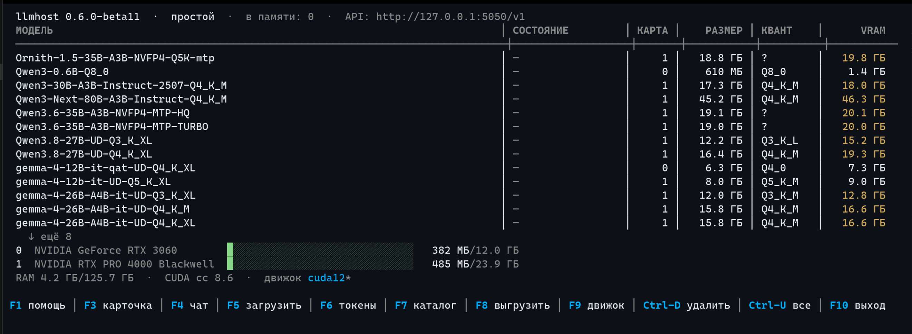

# llmhost

> 其他语言：[Русский](../README.md) · [English](README.en.md) · [Português (BR)](README.pt-br.md)

llmhost 用于在 Linux 操作系统下、在您的计算机上本地运行大语言模型（LLM）。它保障私密性，并支持在离线（自治）环境中工作。它是 llama.cpp 的封装：借助经过优化、自动计算的 LLM 启动参数，实现最充分的系统资源利用率，并显著提升 LLM 的推理速度。

应用由两部分组成：`llmhostd` 是后台服务，负责加载模型并监控显卡显存；`lhctl` 是基于 TUI 的控制台界面，用于管理应用的运行、修改其参数、管理应用所运行的引擎，以及创建和管理用于访问应用 API 的令牌。

应用没有图形界面。这是有意为之：服务运行在终端中，程序通过网络与其通信。

系统核心采用 [llama.cpp](https://github.com/ggml-org/llama.cpp) 的常规构建版本，不含自定义补丁。



---

## 核心功能

- **统一的 LLM 访问接口。** 客户端配置为 BaseURL `http://127.0.0.1:7330/v1`。访问令牌在 `lhctl` 的 TUI 中设置和管理。无论选择哪个模型，BaseURL 与令牌均保持不变。
- **同时服务多个模型。** 显存中可同时驻留多个模型。数量取决于显存（VRAM）的容量。默认不超过两个：例如一个对话模型和一个文档检索模型。请求按名称自行选择模型。若新模型没有足够的空间，则卸载最久未被访问的模型；对它的下一个请求会将其再次载入。
- **多 GPU 配置。** 模型放置在能够完整容纳它的最快的显卡上。加载时若该卡空闲显存不足，则选用下一张有足够空间的卡。任何单卡都无法容纳的模型将分摊到所有卡上。MoE 模型在空间不足时，专家部分放置在内存中。
- **带提示信息的模型目录。** 在 `lhctl` 实用工具中实现了模型搜索（`search` 命令或全屏模式下的目录）。在下载之前即可看到模型能否放下，以及最大上下文是多少。目录界面会显示模型推荐的量化版本。下载中断时支持续传；正在进行的下载可随时停止（`lhctl pull stop` 或界面中的 `Ctrl-X`）——未完成的文件保留，重试时继续。已下载文件的完整性通过 SHA256 算法校验。
- **针对您的硬件自动选取参数。** 每次启动前，llmhost 的算法自行选择上下文大小、KV 缓存压缩方式以及大型 MoE 模型的布局方案。通常可以依赖自动配置——它一般给出最优参数。如需手动模式，可通过 `lhctl` 启用：设置参数 `auto-params = false` 并重新定义其余参数。
- **MTP 的自动识别与挂载。** 原生 MTP 模块或内置 nextn 层（Qwen3.6、GLM）会自动挂载。`lhctl pull` 在下载所选量化的同时，会一并下载配套的 MTP 模块与 vision 投影（若仓库中存在）：同一模型的多个量化中，MTP 选取与主模型相同的类别。可在模型卡片中通过键 `mtp-mode = off/on/auto` 开启/关闭该功能。
- **Thinking 控制。** 模型在回答前的思考过程可按模型开关：`lhctl thinking <模型> auto|on|off`、TUI 模型卡片中的 T 键。模式以 `--reasoning` 标志传给子进程；`auto` 由引擎根据模板自行判断。
- **显存智能驻留。** 无人访问的模型会在闲置 15 分钟后从显存中卸载。模型在 VRAM 中的驻留时间可在设置中指定。来自应用程序、指向该模型的 API 请求会自动将其重新放置到显存中。
- **指标。** `/v0/metrics` 以 Prometheus 格式输出指标：请求、错误、token 数、生成速度、各卡显存——外加按模型采集的引擎精确遥测（解码与预填充吞吐、投机接收率），直接读取运行中的引擎。表格与迷你折线图见 `lhctl metrics -w` 和 TUI 指标屏（按 `m`）。
- **封闭的 API。** 与其他厂商的应用不同，本地 API 要求个人访问令牌。同一台计算机上的无关程序无法在无人察觉的情况下使用模型。此举旨在实现对机器资源的可控使用。

---

## 一条命令安装

安装器从 GitHub Releases 获取静态归档。可执行文件不依赖任何外部组件。**无需 root，也不使用 sudo**：可执行文件安装到 `~/.local/lib/llmhost`，`lhctl` 符号链接创建于 `~/.local/bin`，服务为 systemd **用户**单元，数据存于 `~/.local/share/llmhost`——全部位于家目录内。系统中需具备 `curl`、`tar`、`sha256sum` 和 systemd，应用才能正确安装。

**发行版——Ubuntu。** 开发与测试均在 Ubuntu 上进行；其他发行版不保证完整可用性——未进行测试。静态二进制不依赖系统库，但经过验证的环境是 Ubuntu。

```bash
curl -fsSL https://github.com/bkisonka/llmhost/releases/latest/download/install.sh | sh
```

脚本会询问模型目录并显示默认路径，答案写入配置文件 `llmhost.conf`。可通过标志 `--models-dir 路径` 直接指定目录而跳过询问。随后脚本会校验归档完整性，将 `llmhostd`、`lhctl` 和清单安装到 `~/.local/lib/llmhost`，在 `~/.local/bin` 创建符号链接 `lhctl`（该目录位于 `PATH` 中），注册 systemd 服务并启动，最后安装系统核心——llama.cpp（「引擎」）。若系统中存在 `nvidia-smi`，将选择 `cuda12` 的发行版，否则选择 `vulkan` 的 llama.cpp 发行版。

标志：`--version 标签`（指定具体发行版而非最新版）、`--engine cuda12|vulkan|none`、`--no-engine`、`--no-start`（不触及 systemd）、`--models-dir 路径`。镜像与非常规路径可使用变量 `LLMHOST_BASE_URL`、`LLMHOST_DIR`、`LLMHOST_BIN_DIR`、`LLMHOST_MODELS_DIR`。详见 `install.sh --help`。

**下载来源。** llama.cpp 引擎由守护进程自行下载——仅来自 llama.cpp 官方发行页（github.com/ggml-org/llama.cpp）：地址与 SHA256 固定于 `manifest.json`，不符即拒绝。模型来自 HuggingFace，下载时经 SHA256 校验。没有其他网络来源。**无需通过应用界面下载 llama.cpp**：可从同一页面获取 llama.cpp 发行包并解压到 `<数据目录>/engine/cuda12/`（Vulkan 则为 `engine/vulkan/`）——守护进程会自行将该构建识别为已安装，`lhctl engine` 会以勾选状态显示它；llama.cpp 的搜索是递归的，官方发行包带版本子目录的布局同样适用。安装器也支持完全不带引擎进行安装（参数 `--no-engine`）。任意来源的任意 llama.cpp——通过 `llmhost.conf` 中的键 `[general] llama-server` 指定路径。

**升级**的执行方式与安装相同。守护进程停止、文件替换、服务重新启动。数据、模型与积累的测量数据均保留。若控制端口非默认，升级前请执行 `export LHCTL_PORT=端口`。llama.cpp 本身单独更新：`lhctl engine update`。

所有数据位于 `~/.local/share/llmhost`。若设置了 `$XDG_DATA_HOME`，则为 `$XDG_DATA_HOME/llmhost`。变量 `LH_DATA_DIR` 可覆盖该位置。其中存放配置 `llmhost.conf`、密钥 `token.txt` 与 `api_tokens.json`、引擎、模型和日志 `log.txt`。

### 从零开始的首次运行

```bash
lhctl status                  # 服务已被安装器拉起
lhctl pull qwen3              # 下载模型：量化按你的显卡自动挑选
lhctl chat qwen3 "你好！"     # 对话
lhctl                         # 全屏界面（注册表、目录、聊天）
```

---

## 从源码构建与 systemd 服务

```bash
cmake -S . -B build-linux && cmake --build build-linux -j$(nproc)
LH_LOG_STDERR=1 ./build-linux/llmhostd      # 前台运行
./build-linux/lhctl status                  # 另一个终端
```

**作为服务运行**（主要方式）：systemd 用户单元由脚本 `scripts/install-systemd.sh` 安装。它会写入 `~/.config/systemd/user/llmhostd.service` 并执行 `enable --now`。之后：

```bash
systemctl --user status llmhostd
systemctl --user restart llmhostd   # 修改 llmhost.conf 的端口后
journalctl --user -u llmhostd -f    # 实时日志
loginctl enable-linger              # 开机自启，无需登录
```

单元中设置了 `Restart=always`：守护进程始终处于单元的管理之下。即使是正常退出（`lhctl quit`、SIGTERM），单元也将其视为故障，并在两秒后重新启动守护进程。有意停止只能通过命令 `systemctl --user stop llmhostd` 执行。不建议通过 setsid 或 nohup 手动启动二进制文件：进程会脱离单元的管理。

`KillMode=control-group` 表示停止单元会同时终止守护进程和所有 llama-server 进程。若守护进程在 systemd 之外异常终止，遗留的孤儿进程会在其下次启动时被清理。日志中对应 `orphan:` 行。

发行归档由脚本 `scripts/package_release.sh [版本]` 构建：执行静态构建与单元测试；在 `dist/` 中生成归档 `llmhost-<ver>-linux-x64.tar.gz`、校验和文件以及发布所需文件。

---

## lhctl：简要参考

`lhctl` 是控制 API 的控制台客户端。密钥与数据目录与守护进程使用的相同。在终端中不带参数运行时，将打开全屏界面。

```bash
lhctl                            全屏界面：模型注册表、显存、目录、聊天、令牌
lhctl status                     仪表盘：各卡显存条、模型；-w 实时刷新
lhctl models [--raw]             模型注册表；--raw 按行列出 id
lhctl search qwen3               搜索 HuggingFace 目录：大小、显存估算、
                                 是否装得下（→ lhctl pull）
lhctl pull qwen3                 按名字安装模型：自动选适配显卡的量化
                                 （有 mmproj 和 MTP 模块则一并下载）
lhctl pull stop                  停止正在进行的下载：未完成文件保留，
                                 重复 pull 时继续
lhctl chat qwen3                 终端对话（流式，/bye 退出）
lhctl chat qwen3 "问题"          一问一答（脚本用）
lhctl bench                      对模型基准测试引擎构建
lhctl engine                     引擎：清单 pin、构建、状态
lhctl engine update              最新 llama.cpp b-发布：改 pin 并安装
lhctl engine install cuda12      从当前 pin（重新）安装构建
lhctl engine use cuda12          显式选择运行构建（auto 按硬件）
lhctl load Qwen3-0.6B-Q8_0       加载（注册表名字或 .gguf 路径）
lhctl show Qwen3-0.6B-Q8_0       模型卡片：架构、量化、上下文
lhctl ctx qwen3 32768            手动设置模型上下文（auto 取消）
lhctl set                        [general] 键表并写入配置
lhctl tokens add rag2            命名 /v1 令牌（rm 撤销）
lhctl rm Qwen3-0.6B-Q8_0         永久删除模型（含附属文件；会询问，
                                 --yes 免询问）
lhctl image                      图像生成：状态与画师目录
lhctl image pull z-image-turbo   下载画师（不带名字——内置目录；
                                 或 org/repo，recipes/ 布局）
lhctl image rm flux3-klein       从磁盘删除画师（已加载的由守护
                                 进程自行停止；--yes 免询问）
lhctl image load flux3-klein     加载（unload——停止；模型经由
                                 OpenAI 端口的 /v1/images/* 请求访问）
lhctl unload [模型]              卸载一个（不带名字则全部）；
                                 --force 强制卸载占用中的模型：
                                 中断该模型的所有生成，对所有客户端生效
lhctl mtp qwen3 off              模型投机解码：auto / on / off（同 lhctl ctx）
lhctl quit                       停止守护进程
```

**全屏界面。** 方向键与 PgUp/PgDn 选择模型。`Enter` 或 `F3` 打开模型卡片（`C` 手动设置上下文，`M` 切换 mtp 模式；已加载模型的卡片会显示子进程的实时参数）。`F2` 显示已加载模型的详细状态：各层及其分布、草稿模型、KV。`F4` 聊天，`F5` 将模型载入显存，`F7` 带搜索与量化的目录，`F6` 访问令牌，`F8` 卸载所选模型（若正在生成，会请求确认强制停止），`Ctrl-U` 卸载全部模型，`F9` 引擎（实时安装进度），`Ctrl-D` 从磁盘删除模型，`Ctrl-X` 停止正在进行的下载（任何屏幕）。屏幕数据每秒刷新一次。退出时终端恢复原状。

**自动补全**（bash）：在 `~/.bashrc` 中添加 `source <(lhctl completion bash)`，此后 `lhctl load <TAB>` 会列出注册表中的标识符。

**密钥与端口的确定。** 令牌取自数据目录（`~/.local/share/llmhost`）中的 `token.txt`。控制端口默认为 7331。两个值均可通过标志 `--token` 和 `--port` 或变量 `LHCTL_TOKEN` 和 `LHCTL_PORT` 覆盖。应答输出到 stdout，错误仅输出到 stderr。脚本退出码：**0**——成功，**1**——服务器不可达，**2**——令牌错误（401），**3**——请求错误（404/500），**4**——参数错误。

---

## 模型生命周期：加载、驻留、卸载

- **加载**只需数秒。状态与占用的显存显示在 `lhctl status` 和 `/v0/status` 中。
- **显存智能驻留。** 若在 `unload-after-min` 分钟内（默认十五分钟）没有对模型的访问，它会自动从显存中卸载。对客户端而言这一过程不可察觉：第一个请求会重新放置模型，应答仅延迟数秒。每次卸载都记录在日志中。
- **客户端取消请求会终止生成。** 若客户端断开连接（在应用中取消任务、关闭标签页），守护进程会察觉并终止被抛弃的生成：模型不会空转着嚼完已取消的请求，槽位与占用状态立即释放。该事件写入日志，并由 `client_gone` 指标（`GET /v0/metrics`）统计。
- **手动卸载**——`lhctl unload` 或 `F8` 键。显存立即释放，模型选择会被保留。正在生成的模型未经明确决定不会被触碰——拒绝并附说明；`lhctl unload <模型> --force`（在 TUI 中——通过 `F8` 确认）强制停止模型：其所有生成将对所有客户端中断。
- 显存不足或文件损坏时，日志中会出现相应记录，模型在注册表中被标记为 `failed`。若模型无法完整容纳，调度器会在启动前自动下调参数，并记录具体修改了哪些内容。

---

## 多模型并行服务

守护进程**同时持有多个模型**——数量由键 `models-max` 设定（默认 2；`1` 仅驻留一个模型，`0` 不设上限），且以显存能容纳的为限。每个模型的参数单独计算。

- **加载第二个模型——两个模型都驻留在显存中。** 状态显示在 `lhctl status` 和 `lhctl models` 中。
- **空间不足时，卸载闲置最久的模型。** 该事件记录在日志中。被卸载的模型由下一个请求自动重新载入。
- **每个请求自行选择模型。** 在 OpenAI 请求中对应字段 `model`。名称列表由 `GET /v1/models` 和 `lhctl models --raw` 返回。字段为空时，由最后加载的模型应答。
- **并行请求。** 一个模型可以同时服务多个客户端。键 `parallel`（默认 1）设定线程数。模型的上下文在其间平均分配，内存预算会重新计算以容纳全部。
- **嵌入模型。** BERT 一类家族（nomic-embed、bge、e5、gte）按架构识别；调用通过 `/v1/embeddings` 执行。它们不参与聊天。

---

## 由守护进程编排（harness）

守护进程的运行方式是 harness：加载哪个模型、放到哪张卡、何时加载——这些决策由守护进程而非引擎作出。显存中的每个模型运行**独立的** llama-server 进程。代理按字段 `model` 分发请求。

这样做的原因是 llama.cpp 路由器的内部实现随发行版更迭而变化，每次更新都需要重新验证引擎的行为。在 harness 下，引擎可在不改变守护进程逻辑的情况下替换：布局计划、驱逐、投机解码、vision 与手动上下文均不受影响。

多用户规则：

- **占用中的模型不会被驱逐。** 只要生成仍在进行，无论请求来自何处，模型的槽位都不会被触及。对占用中的模型，`lhctl unload` 和 `POST /v0/unload` 会返回带说明的拒绝。唯一的显式出口：`POST /v0/unload` 携带 `"force": true`（或 `lhctl unload <模型> --force`）将强制卸载模型，对所有客户端中断其全部生成。
- **空间不足时，只驱逐未被占用的模型。** 若新模型缺少内存，守护进程会自动卸载闲置模型并加载新模型。
- **若显存被占用中的模型持有，请求将等待。** 请求进入队列，在相邻模型释放并被卸载后执行。超过 `queue-ttl` 秒（默认 120）后，客户端会收到带说明的 504，而不是一连串难以理解的错误。等待同一模型的请求数由 `queue-depth` 设定（默认 16）。队列可在 `GET /v0/metrics` 的指标 `llmhost_queue_depth`、`llmhost_queue_wait_ms` 和 `llmhost_queue_timeouts_total` 中观察。
- **守护进程重启后模型会恢复。** 曾驻留显存的模型列表保存在 `state.json` 中。

键：`queue-ttl`（值为 0 表示禁止等待：占用时立即拒绝并给出说明）与 `queue-depth`。两者均无需重启即生效。

---

## 多 GPU 配置

服务通过 NVML 识别所有显卡，并自动分配模型。

模型的主卡被指定为其能够完整容纳的最快显卡。显卡按计算能力排序：先比较 compute capability，相同时再比较显存容量。模型即使完整容纳也不下的卡不参与分配。

加载时若主卡空闲显存不足，则使用下一张具有足够容量的卡。手动 `main-gpu` 和 `tensor-split` 的优先级高于此选择。

任何单卡都无法容纳的模型会分布到整个卡池。大于**卡池总容量**的稠密模型以混合模式运行：各层按显存比例分布到各卡，剩余部分（尾部）置于内存。MoE 模型的专家在空间不足时整体移入内存。加载重型模型之前，若按计划空间不足，闲置模型会被自动卸载。

- 放置可行性评估针对模型的目标卡执行。各卡的显存由 `lhctl status` 和 `GET /v0/status`（`gpus` 数组）显示。`lhctl models` 会标明每个模型所在的卡。值为 −1 表示分布到所有卡。
- 手动绑定是模型在 `llmhost.conf` 中的 `main-gpu` 键。这是偏好设置：若指定的卡无法完整容纳模型而另一张可以，守护进程会将模型迁移并在日志中记录：「卡 N 的绑定无法容纳——完整迁移到卡 M」。
- `tensor-split` 明确设定各卡的份额并按其执行。同一键也可用于在小容量卡上强制部分层卸载，例如 `main-gpu = 0` 与 `tensor-split = 1,0`。在解码受处理器限制时，投机解码带来最大的收益（见下节）。
- 两个模型可以绑定到同一张卡。只有两者都能容纳时才可同时运行；否则第一个留在显存中，第二个被标记为 `failed`。此情况下没有基于空间的自动驱逐。
- 引擎以 `CUDA_DEVICE_ORDER=PCI_BUS_ID` 启动。否则 CUDA 会按速度为显卡编号，绑定可能落在另一张卡上。

在配备两块显卡的测试台上（3060 12 GiB 与 RTX PRO 4000 Blackwell 24 GiB，测量日期 2026-10-02），Qwen3.8-27B Q4_K_XL 在切分模式下为 23 tok/s，配原生 MTP 模块为 36 tok/s。MoE 30B-A3B 专家置于内存时为 26 tok/s。目录按所有卡的总容量评估放置可行性。

---

## 添加与删除模型

模型目录就是一个普通文件夹（`models-dir`），llmhost 会自动跟踪它。

- **将 `.gguf` 文件放入目录**（手动下载或从其他计算机复制）：数秒内模型即出现在注册表和 API 列表中。无需重启，已加载的模型不受影响。llama.cpp 形如 `…-00001-of-00004.gguf` 的文件组是一个模型，而不是每个分片一条记录。
- **手动删除文件**——模型同样从注册表中消失。
- **`lhctl rm`**（或全屏界面中的 `Ctrl-D`）删除模型及其全部附属文件：vision 投影、MTP 模块以及组内全部分片。在无图形环境的服务器上没有回收站——删除立即执行且不可恢复。命令会请求确认；标志 `--yes` 可将其关闭。驻留显存中的模型会在删除前自动卸载。

---

## 图像：画师目录

图片生成由第二个引擎（sd-server）提供，它有自己的模型目录：`diffusion_models/`、`text_encoders/`、`vae/`、配方 `recipes/*.json` 以及绑定 `llmhost-image.json`。应用的所有模型共用一套下载机制：

- **`lhctl image pull <名字>`** — 从内置目录下载画师（不带名字则列出清单）：条目对应真实的 HuggingFace 仓库（扩散模型与编码器的量化在 unsloth，VAE 在原作的 comfy 仓库中），校验 SHA256，断点续传。文件按类别落盘，绑定与配方自动写入——模型立即出现在 `lhctl image` 和 `/v1/images/models` 选择器中。
- **自定义来源** — 采用约定布局的 `org/repo` 仓库：恰好一个 `recipes/*.json`（sd-server 格式），且 `diffusion_models/`（`.gguf`）、`text_encoders/`（`.gguf`）与 `vae/` 中各一个文件。
- **`lhctl image rm <名字>`** — 从磁盘删除画师：槽位文件、空闲配方与绑定记录；已加载的模型由守护进程自行停止。会请求确认，`--yes` 可关闭。

按图编辑（`/v1/images/edits`）仅对配方在 `features` 中声明了 `ref_images` 特性的模型可用（引擎自身也读取该配方字段：未声明即视为不支持）。对没有该特性的模型的请求会得到如实的 `400` 与提示，引擎不会被唤醒。

---

## 按模型覆盖参数

自动选取在大多数情况下给出最优结果。若需要单独的值，可在同一个 `llmhost.conf` 中为该模型创建节。节名为不带 `.gguf` 的文件名。修改数秒内生效，无需重启：

```ini
[Qwen3.8-27B-UD-Q4_K_XL]
main-gpu = 1
cache-type = q8_0
ctx-size = 65536
system = 你是值班助手。回答要简短。
```

注释是以 `#` 或 `;` 开头的整行。旧的 `model_overrides.json` 仅在 `llmhost.conf` 不存在时才会被读取。

| 键 | 含义 |
|------|-------|
| `ctx-size` | 模型总上下文（在 `parallel` 线程间平分） |
| `n-gpu-layers` | 放到 GPU 的层数（0 由规划器计算） |
| `main-gpu` | 绑定显卡（0、1、…）；−1 或留空——自动 |
| `tensor-split` | 各卡切分比例，如 `0,1`——全部到卡 1 |
| `cache-type` | KV 缓存：`f16` / `q8_0` / `q4_0` |
| `mtp-mode` | 该模型的投机解码：`on` / `off`——确定性，优先于看门狗和头部；`auto` 由全局键决定（清除覆盖） |
| `system` | 给未自带系统提示的客户端用的系统提示 |
| `model-draft` | 投机解码的草稿模型（id/名字/路径） |
| `spec-type` | `draft-simple`（默认）、`draft-mtp`、`eagle3`、`ngram-*` |
| `draft-card` | `spare`——文件式 `draft-simple` 放到备用卡（harness；MTP 草稿必须与主干同卡——共享 KV 图，挪动会毁掉加载）。意义是腾出主干的显存；弱卡上草稿速度通常更低 |
| `expert-card` | `spare`——完全 `exps=CPU` 时把部分 MoE 专家块放到备用卡（harness；部分形态 `n-cpu-moe` 不受影响） |

**投机解码。** 内置 MTP 的模型（Qwen3.6/3.5、GLM-4.5 及同类）无需任何键即可启用加速。标志 `nextn_predict_layers` 从 GGUF 中读取，投机以 `draft-mtp` 模式运行。

若模型在 Hugging Face 仓库的 `MTP/` 子目录中有原生 MTP 模块，`lhctl pull` 会按量化下载配套文件，加载时自动挂载。若模块未能放下，加载会不带投机重试。关闭开关是 `[general]` 中的 `mtp-mode = off`。不兼容的一对会拒绝加载并说明原因。

草稿可以是任意变体：MTP 模块、同一家族的较小模型，或手动指定的一对。它始终**完整**放置在显卡上，包括自己的层和输出层。主模型在 GPU 上容纳的层数对草稿没有影响。

部分卸载时这一点尤为重要。实测（10-06）：27B 模型在 12 GiB 卡上（65 层中 24 层在 GPU，解码受处理器限制）无投机为 3.6 tok/s，带 MTP 模块为 8.3（×2.3）。MoE 30B 专家置于内存、手动搭配 `model-draft = Qwen3-0.6B-Q8_0`，速度从 29.8 提升到 37.2 tok/s（×1.25）。若无原生 MTP，可使用同一家族、共享分词器的手动搭配：`model-draft` 加 `spec-type = draft-simple`。

**草稿接收率看门狗。** 草稿接受比例因请求而异——即使在同一模型上，也在 0.64 到 0.98 之间。在不利的轨迹上，投机可能比普通生成更慢。

守护进程从进程日志读取统计。窗口按 accepted 与 generated 计数之和计算。若接受率连续三个窗口低于 `draft-accept-floor`，且每个窗口的草稿数不少于 `draft-accept-min-tokens`，自动草稿将被关闭。模型会在无投机状态下重启——直到守护进程重启为止。该决策仅在空闲时、且显存中只有一个模型时作出。手动 `model-draft` 不会被关闭，日志中会写入警告。

例外是 Qwen3.8-Flash-Next：其原生 MTP 头在真实文本上的接受率稳定在 0.32–0.41（五个受检转换无一例外，量化与头部来源均不影响接受率），因此看门狗会自行撤下草稿，模型不带投机运行得更快。

---

## 调度器自适应与显存余量

分析式的放置评估是近似的：由于 MoE 工作区、混合架构和 NVFP4，误差约为一个 GiB 的量级。因此守护进程**根据实际加载进行自适应**。

每次成功加载后，守护进程通过 NVML 测量模型在显存中的实际占用，并将超出权重与 KV 缓存的增量写入 `model_profiles.json`。每种启动形态有自己的槽位：输出层在卡上还是在内存、缓存类型、ubatch、引擎类别、专家是否置于内存、切分时的层数。配置档案可按另一上下文缩放。下一次加载即按其规划。

若分析判定输出层无法放置，守护进程会尝试将其放置到运行中的系统中。内存不足时，执行不带输出层的重启，并保存这次失败。日志中对应 `profiles:` 行。配置档案文件可以删除——调度器将重新开始自适应。

将模型规划进显存时，守护进程在卡上保留 **1.5 GiB 的余量**。llama.cpp 内置的放置探测被禁用（`fit = off`），该余量即取代它。它覆盖相邻卡上 CUDA 上下文的初始化：库会初始化每张可见卡，在几乎占满的卡上这会使启动不可靠。同一余量也覆盖 vision 编码的峰值。上下文预算计入全部负载：vision 投影与草稿模型同权重一起放置在卡上。

MoE 的专家容量从 GGUF 张量列表中精确读取。求和的是名称带「exps」的张量，而不是「文件的百分比」。「内存是否足够」的阈值与留在卡上部分的预算都取决于此。

部分放置专家时，列表按块读取。部分家族的前几个块是稠密的，「每层平均分」会高估外移量。外移通过引擎自带的 `--n-cpu-moe` 标志执行。

「专家置于内存」形态、部分专家放置以及稠密模型的部分切分同样会被建立档案。其占用由两部分组成：显存按实测，内存按已知的文件字节数。

---

## 自动参数调优

该功能默认开启（`auto-params = true`）。每次启动模型前，llmhost 执行以下操作。

- 将**上下文**设置为对该模型和您的显卡而言可能的最大值，而非固定的最小值。现代模型为数万 token。SWA 窗口从 GGUF 元数据读取：gemma-4 的局部层不会削减全局层的上下文。
- **压缩 KV 缓存**到 `q8_0`，但仅当未压缩的缓存无法容纳合理的上下文时。在小模型上，压缩会在没有收益的情况下使速度降低数个百分点。若上下文已手动指定（`ctx-size`）且未压缩的缓存能够容纳，则不启用压缩：f16 下解码更快、质量更高。
- 对**内存受限的 MoE 模型**，首先尝试部分放置专家。前几个块移入内存，其余专家留在卡上。每多保留一个块在卡上，就在每个 token 上省去一次与内存的交换。若该方案放不下或内存不足，专家整体移入内存。
- **考虑模型的读取来源。** 本地磁盘照常采用惰性读取。若模型位于网络磁盘上，llmhost 会在启动后一次性将文件顺序读入页缓存：否则生成的最初几分钟会因冷页面而中断。

每项选择都可在 `/v0/status`（`auto` 块）和日志中查看。若不需要自动化，请设置 `auto-params = false`：计划将不包含自动步骤（KV q8、专家置于内存、预热），`ngl` 采用手动值。`[general]` 中 `ctx` 的语义是**计划的下限**，而非精确固定：调度器不会将上下文降到该值以下，但也不会削减能容纳到自己最大值的模型（实际上：`auto-params = false` 时 `ctx = 8192` 对 qwen3-0.6B 仍给出 40960）。精确的手动上下文是按模型的 `lhctl ctx <模型> <n>`（`ctx-size` 节）：它设定调度器的预算并作为下限工作；无法用它从上方限制模型。

NVIDIA 显卡的显存数据取自 NVML；空闲显存与 `nvidia-smi` 在遥测误差范围内一致。

---

## 接入客户端应用

支持 OpenAI API 的应用需要三个参数。

> **完整 API 契约**——端口、密钥、端点、错误形式与兼容性保证——见 [API.md](API.md)。在运行中的服务器上快速验证契约：`python3 tests/api_e2e.py --quick`。与 Ollama 的对比——[vs-ollama.md](vs-ollama.md)。复现测量使用脚本 `bench_vs_ollama_linux.py`。

- **地址（base URL）：** `http://127.0.0.1:7330/v1`
- **API 密钥：** 数据目录中 `token.txt` 的内容。同一密钥也由 `GET http://127.0.0.1:7331/v0/credentials` 显示。
- **模型名称：** `GET /v1/models` 中的具体名称，例如 `Qwen3-0.6B-Q8_0`。若不指定，由最后加载的模型应答。

从命令行验证：

```bash
TOKEN=$(cat ~/.local/share/llmhost/token.txt)
curl http://127.0.0.1:7330/v1/chat/completions -H "Authorization: Bearer $TOKEN" \
     -H "Content-Type: application/json" \
     -d '{"model":"any","messages":[{"role":"user","content":"你好！"}]}'
```

同样的操作也可以通过 `lhctl` 完成——令牌与端口自动确定：

```bash
lhctl status
lhctl models --raw
lhctl load Qwen3-0.6B-Q8_0
```

脚本可使用端口 `7331` 上的控制 API，密钥相同。状态——`/v0/status`，模型列表——`/v0/models`，加载与卸载——`/v0/load` 和 `/v0/unload`，目录与下载——`/v0/catalog/search`、`/v0/catalog/model`、`/v0/pull`（启动、状态与停止——`DELETE`），引擎测量——`/v0/bench`，密钥——`/v0/credentials`，指标——`/v0/metrics`，退出——`/v0/quit`。

Hugging Face 私有仓库：在启动守护进程之前，将您的令牌放入变量 `HF_TOKEN`。

**安全性。** 默认情况下，两个 API 都监听 `127.0.0.1` 并要求 Bearer 密钥。`token.txt` 自动创建，权限为 0600，密钥为加密随机。浏览器客户端的 CORS 仅对 `localhost` 和 `127.0.0.1` 开放。外部前端加入 `cors-origins`。

**局域网服务：** `[general]` 中设置 `openai-bind = 0.0.0.0` 与 `openai-port = 5050`。OpenAI 端口监听所有接口。此时 Bearer 密钥被强制启用：不存在无密钥的开放 API。控制 API 始终保持在 localhost。

---

## 配置：llmhost.conf

统一的配置文件是数据目录中的 `llmhost.conf`，格式为 INI。`[general]` 节为通用设置，其余节为按模型的覆盖（上文已述）。文件可手动编辑、通过 `lhctl set` 或通过 API（`GET` 和 `POST /v0/settings`）修改。守护进程命令的值也写入此处：`lhctl ctx`、`lhctl engine use` 和 `lhctl engine update`。

大多数键**即时生效**。文件观察器会重建预设，并在数秒内平滑重启子进程。端口、`openai-bind`、`openai-auth` 和 `cors-origins` 在 `systemctl --user restart llmhostd` 之后生效。

```ini
[general]
models-dir = /data/models
ctx = 4096
```

`[general]` 的主要键。完整表见 `lhctl set` 与 [CLI-linux.md](CLI-linux.md) 第 6 节。

| 键 | 默认 | 含义 |
|------|-----------|-------|
| `openai-port` | 7330 | OpenAI 代理端口（需重启） |
| `control-port` | 7331 | 控制 API 与 lhctl 端口（需重启） |
| `openai-bind` | 127.0.0.1 | `"0.0.0.0"`——局域网服务；此时 Bearer 强制（需重启） |
| `openai-auth` | true | :7330 上要求 Bearer 密钥（需重启） |
| `cors-origins` | — | 逗号分隔的受信 CORS Origin（需重启） |
| `queue-ttl` | 120 | 请求排队等待秒数；0 不等 |
| `queue-depth` | 16 | 一个模型最多被多少请求等待 |
| `models-max` | 2 | 显存中保留几个模型（0 无上限，多余按久远度离开） |
| `parallel` | 1 | 每模型并发请求数（上下文在其间平分） |
| `auto-params` | true | 智能调参：能装多少上下文给多少、KV q8_0、按卡分配 |
| `ctx` / `ngl` | 4096 / 999 | 手动上下文与 GPU 层数（`auto-params: false` 时） |
| `ubatch` | 0 | llama-server 物理批；0——引擎默认 |
| `unload-after-min` | 15 | 卸载前的空闲分钟数；0 永不 |
| `gpu-pin` | true | 模型落在能整体放下的最快卡；显存不足则下一张 |
| `auto-draft` / `mtp-mode` | true / auto | 投机：家族小模型或 MTP 模块（`auto\|on\|off`） |
| `draft-accept-floor` | 0.5 | 草稿接收率连续三个窗口低于此阈值，自动草稿关闭且模型无投机重载；0 关闭看门狗 |
| `draft-accept-min-tokens` | 1000 | 少于此草稿数的窗口不被看门狗计入 |
| `models-dir` | `<data>/models` | GGUF 模型目录 |
| `engine-build` | — | 引擎构建（`cuda12` 或 `vulkan`）；空——按硬件 |
| `engine-release` | — | 固定的引擎发布（随附清单中为 `b11476`）；由 `lhctl engine update` 写入 |
| `llama-server` | — | llama-server 路径；空——来自已安装引擎 |
| `moe-cache-mib` | 0 | 显存中的 MoE 热专家缓存：`0` 关、`N` MiB、`-1` 规划器自选。预算计入计划：局促的模型拿得少，不会溢出 |
| `extra-args` | — | 每个 llama-server 的逐字附加参数，空格分隔（用于实验构建与稳定版尚无的标志）；标志含义以所跑引擎为准 |
| `lang` | auto | 界面语言：`auto`——按机器本地化决定（俄语环境→俄文，其他→英文）；`ru`/`en` 为强制；即时生效（lhctl/TUI 与守护进程的客户端应答） |

### 从实验性引擎回退

若模型依赖第三方引擎构建运行（`llama-server` 键指向它，`extra-args` 携带其标志）而出现问题——回退到正式发行版只需数秒，且无需重新安装：

```ini
[general]
llama-server =
moe-cache-mib = 0
extra-args =
```

观察器会即时应用这些键，下一个请求会将模型置于已安装发行版的引擎上。第三方构建位于单独的目录中，不会妨碍 `lhctl engine update`；待正式引擎更新吸收了所需能力后，第三方构建和附加标志可直接删除。

工作状态（`last_model`、`mtp_choices`）单独保存在 `state.json` 中。它不属于配置文件。带有旧 `config.json` 的安装在新的守护进程首次启动时自动迁移。

---

## Prometheus 指标

控制 API 上的 `GET /v0/metrics`，在同一 Bearer 令牌之下，返回 Prometheus 格式的文本：按模型的请求、字节与错误，来自应答 usage 的 token 数，时长，平滑后的每秒 token 速度，各卡 VRAM 与模型的实时状态。

抓取器在 `prometheus.yml` 中配置 `bearer_token`。对局域网内的客户端而言，这是主要的观测点，无需在 `log.txt` 中翻找。

---

## 故障排查

- **日志。** `journalctl --user -u llmhostd -f` 和数据目录中的 `log.txt`（1 MiB 轮转）。报告问题时首先使用这些信息：版本、参数选择、拒绝原因、驱逐以及 `orphan:` 行。
- **「端口被占用」。** 端口 7330 或 7331 已被其他进程占用。请在 `llmhost.conf` 中修改端口并执行 `systemctl --user restart llmhostd`。
- **模型「放不下」。** 请在目录中选择更轻的量化——选项按容量升序排列——或更小的模型。每个选项都标注了所需显存容量。
- **「仓库不存在、为私有或需要令牌」。** 仓库为私有。请在 huggingface.co 获取免费令牌并设置 `HF_TOKEN`。
- **「第二个守护进程无法启动」。** 守护进程已在运行：每个数据目录只有一个实例，通过 pid 锁控制。
- **应用更新后引擎「不对」。** 固定的版本保存在 `engine-release` 中，在更新后依然保留。意图与事实的不一致可在 `lhctl engine status` 中看到：字段 `installed_release` 和 `mismatch`。

---

## 文档

- [CLI-linux.md](CLI-linux.md)——实用参考手册：全屏模式、全部 lhctl 命令、控制 API 的 curl 示例、配置、诊断。
- [API.md](API.md)——OpenAI 兼容 API 与控制 API 的完整契约。
- [vs-ollama.md](vs-ollama.md)——测量数据与 Ollama 的对比。
- [RELEASE_NOTES.txt](../RELEASE_NOTES.txt)——当前发行版的新特性。

---

## 许可证

专有许可。全文见 [LICENSE](../LICENSE)（v1.2）。允许不经作者同意进行个人非商业使用与代码修改，但仅限个人用途；公开发布修改版本时，必须明确注明其来源，不得将其冒充为原版——仅保留在自己设备上的私人修改不产生任何义务。复制、分发、发布及商业使用——须经权利人（github.com/bkisonka）事先书面许可。v0.6.0-beta11（含）之前的发行版按双 GNU GPL（v2——个人，v3——商业）分发。已获取的副本仍按其条款执行。引擎 llama.cpp 为 MIT（github.com/ggml-org/llama.cpp）。它不包含在发行包中：首次启动时单独下载，并继续遵循其自身许可。许可的俄文文本为具约束力版本。
